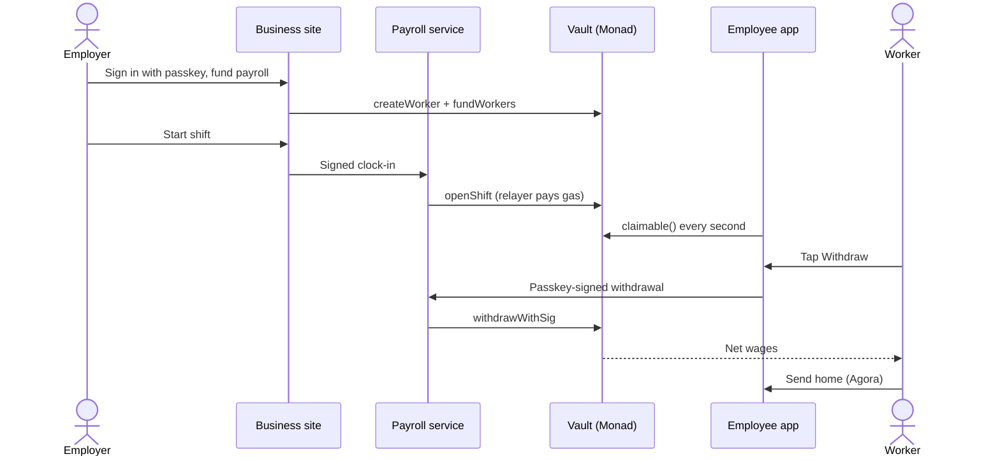
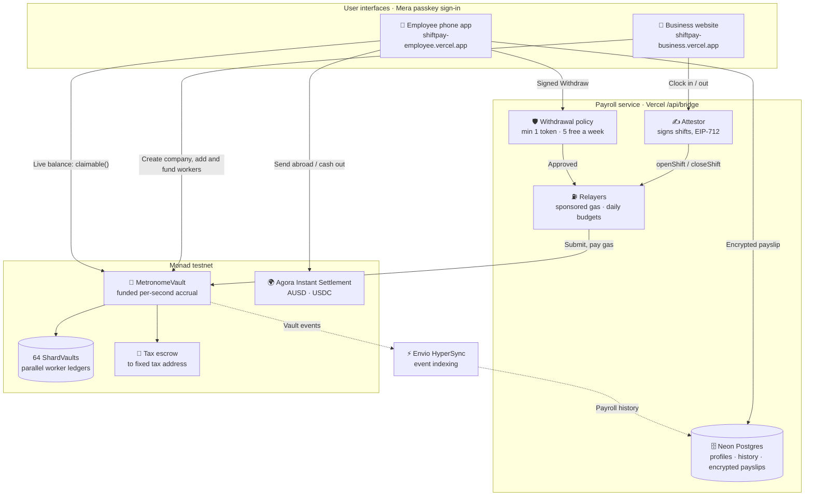
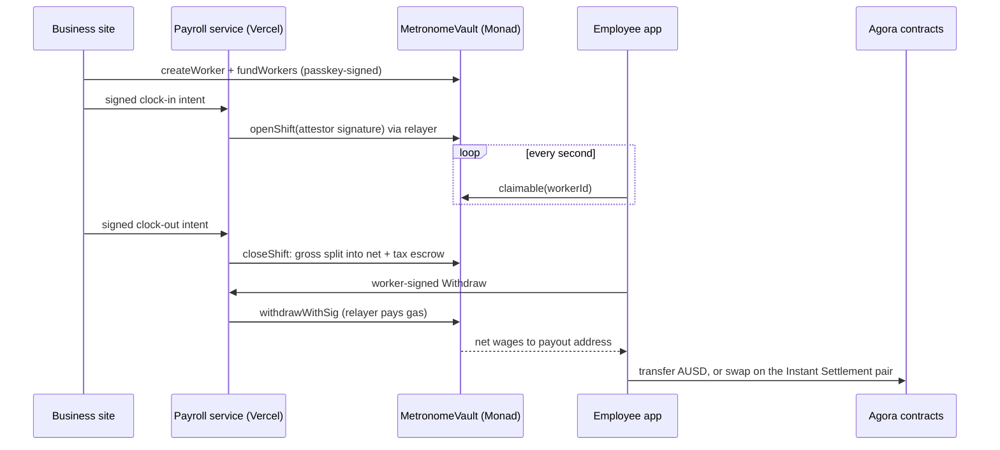

<p align="center"></p>

# ShiftPay

Get paid for the hours you have already worked, the moment you work them, on Monad.

ShiftPay is payroll for shift workers that pays as time passes instead of every two weeks. A
business deposits USDC or AUSD into a **payroll vault** and gives each employee an allocation.
When the business verifies a shift, the employee's wages grow every second, capped by the money
actually deposited, with tax held separately in escrow. The employee withdraws any amount at any
time, without paying gas and without a fee, and can send AUSD to anyone or cash out through
**Agora Instant Settlement**.

Nobody installs a wallet. The business and the employee each sign in with a **Mera passkey**,
which turns a fingerprint, face or PIN into a signing key inside the browser. No seed phrase,
no extension and no approval pop-ups.

Employees who would otherwise borrow against wages they have already earned are the people this
is built for. The money is already theirs; only the payment timing was wrong.

- **Network**: Monad testnet (chain 10143)
- **Contracts**: `contracts/`, Foundry
- **App**: Next.js business website and employee mobile wallet, in `app/`
- **Payroll service**: `bridge/`, runs inside the business Vercel project with Neon Postgres

| | |
|---|---|
| Business website | https://shiftpay-business.vercel.app |
| Employee mobile wallet | https://shiftpay-employee.vercel.app |
| USDC payroll vault | [`0xA1C794EA48A1D86294848D28E85c76328070DB24`](https://testnet.monadscan.com/address/0xA1C794EA48A1D86294848D28E85c76328070DB24) |
| AUSD payroll vault | [`0xc118d4E298284192DAabE328eC236c3468a9E185`](https://testnet.monadscan.com/address/0xc118d4E298284192DAabE328eC236c3468a9E185) |

### Submission at a glance

| | |
|---|---|
| Hackathon | Monad Metropolis 2026 · Track 02 Consumer Products & Payments |
| Bounties | Agora Cross-Border Payments · Best Mera-Powered UX · Mera: One Passkey, Many Keys · Best Use of Envio · Best Projects using Alchemy |
| Builder | Lakshmikanth S (solo), final year, Loyola-ICAM College of Engineering and Technology, Chennai |
| Why it is not a stream | Pay is funded first, tied to signed shifts, tax withheld in escrow, and never clawed back |
| Early feedback | Survey of 5 part-time student workers: all often short before payday, 4 of 5 paid 2+ weeks late, average interest 4.2/5, all found the live app easy ([PRD §4](docs/METRONOME_PRD.md#4-current-status-and-proof)) |

---

## Contents

1. [The idea in detail](#the-idea-in-detail)
2. [How ShiftPay works, in pictures](#how-shiftpay-works-in-pictures)
3. [A simple sequence diagram](#a-simple-sequence-diagram)
4. [How to use ShiftPay](#how-to-use-shiftpay)
5. [Two apps, one vault](#1-two-apps-one-vault) and the technical sections that follow
6. [Feedback for sponsor technologies](FEEDBACK.md)

---

## The idea in detail

### The problem

Work happens every hour. Payroll pays every two weeks or every month. In between, rent, food and fees are due, so
people who live shift to shift borrow against wages they have **already earned**:

- US workers pay about **$4.6B a year** in payday-loan fees; the average borrower pays about **$520** to borrow **$375**.
- About **10 million** workers took **$32B** through wage-advance apps in 2022, and about **90%** paid a fee.
- Migrant workers pay again, and wait days, to send part of their pay home.

The money is already theirs. Only the **timing** is wrong. A loan or an advance is a paid patch over a timing problem.

### The idea

**Remove the gap instead of lending into it.** If the employer deposits payroll first and the wage is recorded as it
is earned, the worker can simply take what is theirs, whenever they want, for free. Nothing is lent, so there is
nothing to charge for.

ShiftPay is that system:

| Principle | What it means in ShiftPay |
|---|---|
| **Funded first** | The employer deposits AUSD or USDC into a payroll vault before work starts. Pay can never exceed what was deposited, so it is never a loan |
| **Tied to verified work** | Pay grows only during a shift that the employer's service has signed (EIP-712) and settled on Monad |
| **Tax withheld** | Every second of gross pay is split into net wages and tax escrow; escrow can only go to the company's fixed tax address |
| **Never clawed back** | The employer can reclaim only unearned money; a correction changes future pay, never money already withdrawn |
| **Invisible crypto** | Workers sign in with a passkey (fingerprint, face or PIN). No wallet app, no seed phrase, no gas |
| **Free to the worker** | The employer pays network fees through a relayer; the worker never pays |

### A wage is not a stream

Money-streaming tools pay a committed amount on a timer. Payroll needs more than a timer:

```text
  STREAMING (a timer)                      SHIFTPAY (a wage)
  ───────────────────                      ─────────────────
  amount committed up front                money deposited up front, capped per worker
  flows because time passes                flows only during a signed, verified shift
  no notion of tax                         tax split off every second into escrow
  sender can often cancel / claw back      earned money can never be taken back
  user needs a crypto wallet               user needs only a passkey
```

### Who it is for

| Person | Uses | Needs |
|---|---|---|
| **Shift worker** (café, delivery, retail, event staff, campus jobs) | Employee phone app | Earned money now, without a loan, without crypto |
| **Salaried staff** | Employee phone app | Salary that accrues every second of the month; leaving mid-month pays exactly the time worked |
| **Migrant worker** | Employee phone app | Send part of the pay home instantly, at a fixed price, with no fee |
| **Employer** | Business website | Simple payroll, fewer staff leaving over cash-flow stress, no cash handling, automatic withholding |

### Pay types

```text
  SHIFT PAY                                  MONTHLY SALARY
  ─────────                                  ──────────────
  rate per hour, only while a shift          monthly amount ÷ 720 hours,
  is open (e.g. 36 AUSD/h = 0.01 AUSD/s)     every second for up to 31 days

  clock in ──▶ pay grows ──▶ clock out       start month ──▶ pay grows all month
                                             leave early ──▶ pays exactly the time worked
```

---

## How ShiftPay works, in pictures

### 1. The whole system

```text
 ┌──────────────────────────┐              ┌──────────────────────────┐
 │   BUSINESS WEBSITE       │              │   EMPLOYEE PHONE APP     │
 │   (laptop, passkey)      │              │   (phone, passkey)       │
 │  fund · add staff ·      │              │  live balance · withdraw │
 │  start/end shifts · tax  │              │  send home · payslips    │
 └────────────┬─────────────┘              └─────────────┬────────────┘
              │ signed requests                          │ signed requests
              ▼                                          ▼
 ┌─────────────────────────────────────────────────────────────────────┐
 │              PAYROLL SERVICE  (Vercel · /api/bridge)                │
 │   attestor: signs shifts     relayer: submits & pays gas            │
 │   withdrawal policy · gas budgets · Neon Postgres · Envio indexer   │
 └───────────────────────────────────┬─────────────────────────────────┘
                                     │ transactions
                                     ▼
 ┌─────────────────────────────────────────────────────────────────────┐
 │                         MONAD TESTNET                               │
 │   MetronomeVault ── 64 ShardVaults (funds)   tax escrow             │
 │   Agora AUSD · Agora Instant Settlement pair (send home / cash out) │
 └─────────────────────────────────────────────────────────────────────┘
```

### 2. How money moves

```text
  EMPLOYER WALLET                 PAYROLL VAULT                      WORKER WALLET
  ───────────────                 ─────────────                      ─────────────
   200 AUSD  ──── fund ────▶  ┌──────────────────────┐
                              │ funded: 200          │
                              │ ▓▓▓▓░░░░░░░░░░░░░░░░ │  pay grows each second
                              │ earned  ─┬─ net 90%  ├── withdraw ──▶  net wages
                              │          └─ tax 10%  │
                              └─────────┬────────────┘
                                        │ remit (company only)
                                        ▼
                                  FIXED TAX ADDRESS
   unearned money ◀── reclaim ── (only what is NOT earned or reserved)
```

### 3. One worker's day

```text
  08:58  Manager taps "Start verified shift"
           │  attestor signs  →  relayer submits openShift  →  Monad (~1 s)
           ▼
  09:00  ┌──────────────────────────────┐
  →      │  Earned wages     0.01 AUSD  │   the phone reads claimable()
  13:00  │  Earned wages    144.00 AUSD │   every second; nothing is
         └──────────────────────────────┘   written on chain as time passes
           ▼
  13:05  Worker taps "Withdraw"  →  signs with passkey  →  relayer pays gas
           ▼
  13:05  Money in the worker's wallet (seconds later)
           ▼
  13:06  "Send abroad · instant"  →  Agora Instant Settlement  →  family receives
           ▼
  17:00  Manager taps "End verified shift"  →  closeShift splits net + tax escrow
```

### 4. Withdrawal decision

```text
                      Worker taps Withdraw
                               │
                 amount ≥ 1 AUSD or whole balance?
                     ┌─────────┴─────────┐
                    yes                  no ──▶ "Free withdrawals start at 1 AUSD"
                     │
         fewer than 5 sponsored this week?
            ┌────────┴────────┐
           yes                no
            │                 │
  relayer submits         app calls withdraw() from the worker's
  withdrawWithSig         own wallet, using the daily gas grant
  (employer pays gas)     (wages are never locked)
            └────────┬────────┘
                     ▼
            net wages arrive in seconds
```

### 5. One passkey, two keys

```text
                       ┌───────────────────┐
                       │   ONE PASSKEY      │  fingerprint / face / PIN
                       └─────────┬─────────┘
                PRF salt A       │        PRF salt B
          (account namespace)    │   ("shiftpay.payslips.v1")
                ┌────────────────┴────────────────┐
                ▼                                  ▼
       signing key (Mera)                 HKDF-SHA-256
       signs payroll actions           ┌──────┴───────┐
       and withdrawals                 ▼              ▼
                                  AES-256-GCM      storage id
                                  payslip key      (unlinkable)
                                       │
                                       ▼
                              server stores ciphertext only
```

### 6. Worker reports a problem

```text
  Worker: "Something wrong with my hours or pay?"
     │  types what looks wrong · signs with passkey
     ▼
  Payroll service stores the signed report (max 5 a day)
     │
     ▼
  Business site: "⚑ 1 reported" next to the employee, full text on their page
     │
     ▼
  Employer checks the shift; a correction changes future pay only
```

---

## A simple sequence diagram



---

## How to use ShiftPay

Everything runs on Monad testnet with free test tokens. Use Chrome. No account, password or wallet is needed; each
app creates its account from a passkey on your device.

### As a business (laptop)

1. Open **https://shiftpay-business.vercel.app/employer**.
2. Type your company name and tap **Create company passkey**. Confirm with your fingerprint, face or PIN.
3. Choose **AUSD** in the Currency box (top right), then **Create my company**. The network fee is sponsored.
4. Go to **Funding** and tap **Get 10,000 test AUSD (Agora)**.
5. Go to **Employees → + Add employee** and fill in:
   - **Shift pay** or **Monthly salary**;
   - name, role, department;
   - an **Employee ID** (any unused number) and the employee's wallet address from their app (step 2 below);
   - hourly rate (e.g. 360) or monthly salary, tax withholding (e.g. 10%), and funding (e.g. 200).
   Tap **Register and fund employee**.
6. Go to **Shifts → Start shift… → Start verified shift**. Their pay starts growing.
7. Later, tap **End verified shift**. Tax moves to escrow; on **Funding**, **Send … to tax account** remits it.
8. **Payments** shows the history indexed by Envio. An employee with a "⚑ reported" flag has sent a signed report.

### As an employee (phone)

1. Open **https://shiftpay-employee.vercel.app/employee**, type your name, tap **Create payroll passkey**.
2. Tap **Receive** and give the address (or pay ID) to your employer.
3. When your employer adds you, your payroll appears on **Home** automatically, and your balance grows every second
   during a shift.
4. Tap **Withdraw to my wallet**. Withdrawals of at least 1 AUSD are free, 5 a week; the money arrives in seconds.
5. **Send → Send abroad · instant** sends AUSD home through Agora Instant Settlement. **Direct transfer** sends AUSD to
   any address.
6. **Cash out** settles AUSD instantly at a fixed price.
7. **Profile → Private payslips → Save today's payslip** keeps an encrypted payslip only your passkey can open.
8. If hours or pay look wrong, open **Something wrong with my hours or pay?** on Home and send a signed report.
9. New phone? Sign in with the same passkey; the same account and payroll come back.

### Good to know

- The key that your passkey unlocks lives only in the open tab and is wiped after 15 minutes; one scan unlocks again.
- Free withdrawals start at 1 AUSD (or your whole balance) and are limited to 5 a week; after that the app withdraws
  directly from your wallet, so your wages are never locked.
- If your employer's funding runs out mid-shift, the app shows "Earning paused" until they add funds; what you earned
  is safe.

---

## 1. Two apps, one vault

### System architecture



### Business: a website

| Step | What the owner does | What happens underneath |
|---|---|---|
| Sign in | Unlock company passkey, or **create one** with a single scan | The passkey's PRF output is turned into the company key in the browser tab, wiped after 15 minutes |
| Create a company | Name it; one step | `createEmployer` on the shared vault with ShiftPay's attestor; a free fee credit covers the gas. Any business (or judge) can self-onboard |
| Get money | Get 10,000 test AUSD, or test USDC | Agora's faucet `requestFunds` is called and signed by the passkey |
| Hire | Add employee: **Shift pay** (hourly) or **Monthly salary**, wallet, tax %, allocation | `createWorker` (salary = monthly ÷ 720 h, 31-day period), then `fundWorkers`, then a signed profile save |
| Verify work | Start / end verified shift, or start / end the salary month | A signed clock intent goes to the payroll service, whose attestor signs and whose relayer submits |
| Pay tax | Funding → Send to tax account | `remitWithholding` moves escrowed tax to the fixed tax address |
| Watch | Overview, payments, tax escrow | Vault events indexed into Postgres; balances read live from the vault |

### Two pay types

| Pay type | How it accrues | Employer action |
|---|---|---|
| **Shift pay** | Every second during a verified shift (up to 8 hours) | Start and end each shift |
| **Monthly salary** | Every second of the month, day and night: monthly ÷ 720 hours | Start the salary month once; end it at month end (or early, paying only the time worked) |

Both use the same vault rules: never more than funded, tax held in escrow, withdraw any time.

### Employee: a mobile wallet

| Step | What the worker does | What happens underneath |
|---|---|---|
| Sign in | Create passkey, share address from Receive | A different site, so a different passkey and a different address |
| Earn | Link employee ID, watch the balance grow | `claimable()` read every second; nothing is written as time passes |
| Withdraw | Tap Withdraw | Worker signs EIP-712 `Withdraw`; the employer's relayer submits and pays gas |
| Send | Send AUSD to family, any address | Plain ERC-20 transfer signed by the passkey |
| Cash out | Settle AUSD instantly | Agora pair `swapExactTokensForTokens`, fixed price, zero fee |

### End to end



---

## 2. The payroll vault

### How money moves

```
     BUSINESS                       VAULT (64 shards)                    EMPLOYEE
 ┌───────────────┐            ┌───────────────────────┐           ┌───────────────┐
 │ USDC / AUSD   │─fundWorkers▶│ funded allocation     │           │ payout wallet │
 │               │            │   │ accrues per second │           │               │
 │ reclaim       │◀─unearned──│   ▼ (verified shifts)  │─withdraw─▶│ net wages     │
 └───────────────┘            │ net ───────────────────┤           └───────────────┘
                              │ tax ──▶ tax escrow ────┼─remit──▶ fixed tax address
                              └───────────────────────┘
```

Money leaves the vault by three paths only: a worker-signed withdrawal to the registered payout
address, a remittance of escrowed tax to the employer's tax address, or the employer reclaiming
allocation that has not been earned. Each is bounded by deposited funds.

### Accrual arithmetic

Amounts are token base units (6 decimals). Each closed shift is split when it closes:

```
gross = ratePerHour × (endAt − startAt) / 3600
tax   = gross × withholdingBps / 10000      rounded down, in the worker's favour
net   = gross − tax
```

What the employee app shows:

```
claimable = max(0, min( earnedNet − withdrawn,
                        funded − earnedTax − withdrawn ))
```

**The second term is the part worth reading.** Earnings alone would let a worker draw money the
employer never deposited. Capping by `funded − earnedTax − withdrawn` means wages stop growing
when the allocation runs out, tax is reserved before net pay, and a top-up resumes accrual from
the moment it lands without back-paying the gap. Accrual is a `view`: no transaction is written
while time passes, so a ticking balance costs nothing.

### Design decisions

| Decision | Why |
|---|---|
| Fully funded, accrual capped by deposit | No credit, no advances, no lender. A worker can only take money that already exists. |
| `ratePerHour`, not per second | $24/h is 6,666.67 units/s at 6 decimals and cannot be stored exactly. |
| Tax address immutable per employer | If the admin could change it, withheld tax could be redirected. |
| Worker-signed withdrawals, relayer submits | The worker pays no gas, and the relayer cannot change amount or recipient. |
| 64 shards by `workerId % 64` | Workers in different shards write different storage, so a shift change of hundreds of clock-outs does not serialise. That is what Monad's parallel execution needs. |
| Per-shift replay records, no shared bitmap | A shared bitmap word would be written by every worker and become the bottleneck. |
| Over-withdrawals recovered from future accrual | A shorter final shift is netted against later earnings, never clawed back from a wallet. |

### The contracts

| File | Responsibility |
|---|---|
| `MetronomeVault.sol` | Employers, workers, funding, signed shifts and corrections, withdrawals, tax escrow and remittance |
| `ShardVault.sol` | Minimal clone per shard that holds tokens |
| `test/MetronomeVault.t.sol` | 38 unit and fuzz tests, including month-long salary accrual |
| `test/invariant/` | 5 stateful invariants: solvency, conservation, no unbacked claims, monotonic totals, all earnings funded |

---

## 3. Agora and Mera

The Agora bounty asks for a mobile app that sends AUSD across borders, with Mera passkey
onboarding and Agora's Instant Settlement contract on Monad testnet. Every line maps to a screen:

| Requirement | Where | Contract |
|---|---|---|
| Mobile app | Employee wallet, installable, phone-first | |
| Mera passkey onboarding | Both apps | `@category-labs/mera` |
| Send AUSD across borders, settled instantly | Send → *Abroad · instant settlement*: the sender's AUSD goes through Agora's pair and the recipient receives the settled currency in the same transaction | AUSD `0xa9012a055bd4e0eDfF8Ce09f960291C09D5322dC` |
| Instant Settlement | Cash out screen | CTK/AUSD pair `0x1Aa8958Aa34cEC8096EF4381cb335effe977b0ae` |
| Test AUSD | Get AUSD button | Faucet `0xd236c18D274E54FAccC3dd9DDA4b27965a73ee6C` |
| Agora public API | Live AUSD supply on Monad shown beside every transfer | `GET https://api.agora.finance/v0/metrics` |

The first cash-out registers the account with Agora's testnet whitelister
(`0x7c10F56d6f04a51376393a1C3670e966863F6BD5`), approves AUSD, then swaps. Each step is a
confirmed transaction with an explorer link. The pair is checked against Agora's published
token order before any swap.

### Mera is the entire account layer

| Requirement | How ShiftPay meets it |
|---|---|
| One-prompt onboarding | One passkey ceremony creates the account. No seed phrase, extension, email or OTP. |
| Prompt-free signing, scoped session | After unlocking, payroll actions sign without prompts for 15 minutes; then the key is wiped and the next action asks again. |
| Stateless test | Clear storage or use a new device: the passkey re-derives the same address, the app finds the payroll registered to that address on chain, and private payslips decrypt again. |
| Time to first transaction | New accounts get a small network-fee credit automatically from the payroll relayer (one per address, capped per day), so the first transaction needs no faucet. |
| No custody backend | Keys exist only in the browser tab. The server holds payroll records and ciphertext, never keys. |

### One passkey, many keys: private payslips

The wallet key comes from Mera's default PRF salt. Payslips use a second, unrelated namespace,
`sha256("shiftpay.payslips.v1")`. HKDF turns that PRF output into an AES-256-GCM key and an opaque storage id.
The phone encrypts each payslip; the server stores ciphertext under an id it cannot link to any wallet. On a
second device the same passkey re-derives the same key and id and the payslips decrypt live. Nothing secret
is persisted anywhere. See `app/lib/private-payslips.mjs` and its tests.

**On testnet the pair settles AUSD → CTK only.** The reverse quote returns zero, so the app
offers only the direction that works rather than a button that fails.

---

## 4. Hosting the payroll service on Vercel

The bridge is a Fastify service. Instead of a separate always-on server it is bundled into the
business Next.js app and served from `/api/bridge/*`.

| Concern | How it is handled |
|---|---|
| No resident process | After each request, `Submitter.settle()` submits queued transactions and waits for receipts within the function's time budget. Unfinished work resumes on the next request. |
| Database | Neon Postgres through the Vercel Marketplace, one schema per token. Prisma migrations run during the build. |
| Indexing | **Envio HyperSync** feeds vault events into Postgres with a persisted cursor (the public RPC caps `eth_getLogs` at 100 blocks). `/api/bridge/health` reports `envio-hypersync ok` |
| RPC | A dedicated Alchemy Monad endpoint first, with public Monad RPCs as automatic fallbacks, plus short read caches |
| Many companies | Serves every company that registered ShiftPay's attestor; self-serve companies have daily sponsored-gas budgets |
| Employee site | Relays to the business project with a shared secret. One payroll service, one source of truth. |
| Startup checks | Chain id, vault bytecode, settlement token, decimals, registered attestor and expected admin are verified before serving. A mismatch refuses to start. |

---

## 5. Trust, honestly

| Actor | Can | Cannot |
|---|---|---|
| Employer admin | Create workers, fund, reclaim unearned money, suspend, rotate attestor | Withdraw wages, redirect withheld tax, reclaim earned money |
| Attestor (payroll service) | Sign shift open, close and corrections | Move money, attest beyond funding, replay a shift |
| Relayer (payroll service) | Pay gas to submit signed records and withdrawals | Withdraw without the worker's signature, change amount or recipient |
| Employee | Withdraw up to `claimable`, any time | Draw unfunded or unverified wages |

The chain proves every paid amount traces to a signed shift and to deposited money. It does
**not** prove the hours were truly worked: that remains the employer's timekeeping, the same
trust a worker places in payroll today, except now every record is signed and public.

Withholding is a flat, employer-chosen rate held in escrow and sent to a fixed address. It is not
a statutory tax calculation and files nothing.

Gas is flat per transaction. A withdrawal used 116,205 gas at 102 gwei on Monad testnet (about
0.012 MON, 10 Oct 2026), the same for $1 or $500, so very frequent tiny withdrawals cost the
employer more per dollar paid.

---

## 6. Proof on Monad testnet

| What | Result |
|---|---|
| Live agent (`npm run test:agent`) | 26/26 checks on the deployed sites with a virtual passkey: onboarding, fee credit, Agora faucet, send abroad via Instant Settlement, direct send, cash out, payslips, stateless re-login, judge creates a company |
| Monthly salary, owner's own run | 2,592 AUSD/month employee; salary accrued every second; mid-month withdrawal `0x350d5fc1…f524fa` paid by the company's relayer |
| Shift-change benchmark | 16 workers × open/close/withdraw on a 64-shard vault and a single-storage control: 96 transactions, 0 failures, p50 ≈ 2 s. At this size the designs perform the same; see [benchmark/README.md](benchmark/README.md) |
| Envio HyperSync indexing | `/api/bridge/health` reports `envio-hypersync ok`; payroll lookup by address and the Payments ledger read indexed events |
| Contract tests | 43 Foundry tests including 5 invariants; Slither 0 high |
| Security review | [docs/SECURITY.md](docs/SECURITY.md): automated checks, Slither triage, fixes and known limits |
| Limitations and roadmap | [docs/LIMITATIONS.md](docs/LIMITATIONS.md): each known drawback, what is done now and what comes next |

---

## Tech stack

| Layer | Technology |
|---|---|
| Contracts | Solidity 0.8.28, Foundry, OpenZeppelin (SafeERC20, EIP-712, ECDSA, Clones) |
| Chain | Monad testnet, chain id 10143 |
| Accounts | Mera passkeys (`@category-labs/mera`), WebAuthn PRF |
| Frontend | Next.js 16 (App Router), React 19, viem, plain CSS |
| Payroll service | Fastify, TypeScript, zod, Prisma, bundled into the business Next.js app |
| Database | Neon Postgres (Vercel Marketplace) |
| Payments | Agora AUSD, USDC, Agora Instant Settlement pair and public API |
| Indexing and RPC | Envio HyperSync; Alchemy Monad RPC with public fallbacks |
| Hosting | Vercel (business and employee projects) |
| Testing | Forge unit/fuzz/invariant tests, Vitest, Node test runner, live CDP agent with a virtual passkey, Slither |

## Why Monad

ShiftPay turns payroll from one batch every two weeks into many small actions: shifts opening and closing, and
workers withdrawing whenever they want. That only works on a chain where those actions are cheap and fast.

- **About 1-second blocks and sub-cent fees** make per-second wages and on-demand withdrawals practical; a worker
  sees money land in seconds, and the employer can afford to sponsor the fee.
- **Pay is computed on read**, so nothing is written as time passes; on-chain writes happen only at shift changes,
  funding and withdrawals.
- **Parallel execution:** shift change is a burst (a whole workforce clocks out and withdraws at once). The vault
  spreads workers across 64 shard vaults so their accounting never shares storage slots, letting independent
  workers' transactions execute in parallel. Our 16-worker testnet benchmark (96 transactions, 0 failures, about
  2 s) showed no measurable shard advantage yet at that size; we report that honestly and expect the benefit at
  larger bursts.
- **Full EVM compatibility** let us use Solidity, Foundry, OpenZeppelin, viem and EIP-712 unchanged.

## 7. Configuration and deployment

### Prerequisites

- Node 24, Foundry (`forge`)
- A Vercel account with Neon connected to the business project
- Test MON for the company account and the relayer

### Run locally

```bash
cd contracts && npm ci && forge test
cd ../bridge && npm ci && npm run generate && npm run typecheck
cd ../app && npm ci && npm run dev
```

Open http://localhost:3000/employer and /employee.

### Deploy

Create the company passkey and payroll vault from `/deploy` on the business site; it signs the
real deployment and employer registration. Then set both Vercel projects' variables from the
ignored keys file without printing secrets:

```bash
cd app
node scripts/configure-vercel.cjs
vercel deploy --prod
```

After deploying an AUSD vault, add it with
`node scripts/configure-vercel.cjs ausd <vault> <deployBlock> <employerId>` and redeploy.

### Environment

| Variable | Project | Set by | Purpose |
|---|---|---|---|
| `PAYROLL_BACKEND=local` | business | `configure-vercel.cjs` | Run the bridge in-process |
| `DATABASE_URL` | business | Neon integration | Postgres |
| `USDC_VAULT_ADDRESS`, `USDC_VAULT_DEPLOY_BLOCK`, `USDC_EMPLOYER_ID` | business | `configure-vercel.cjs` | Which vault to serve and index from |
| `USDC_ATTESTOR_PRIVATE_KEY`, `USDC_RELAYER_PRIVATE_KEYS` | business | `configure-vercel.cjs` | Shift signing and gas (same for `AUSD_`) |
| `EXPECTED_EMPLOYER_ADMIN` | business | `configure-vercel.cjs` | Refuse a vault whose admin is not the company passkey |
| `BRIDGE_ORIGIN`, `BRIDGE_RELAY_SECRET` | employee | `configure-vercel.cjs` | Relay to the business payroll service |
| `METRONOME_PRODUCT` | both | Vercel | `employer` or `employee` |

Private keys live only in `bridge/.env.runtime-keys` (gitignored) and Vercel's sensitive
variables. Nothing secret is `NEXT_PUBLIC`.

### Tests

| Command | Where | Covers |
|---|---|---|
| `forge test` | `contracts` | 43 tests: 38 unit/fuzz (including month-long salary) + 5 invariants |
| `npm run typecheck && npm test` | `bridge` | Types, unit, Envio and Postgres integration |
| `npm test` | `app` | 42 tests: passkeys, funding, Agora (live read-only), private payslips, pay plans |
| `npm run test:live` | `app` | Both deployments: health, config vs chain, route separation, origin checks |
| `npm run test:agent` | `app` | Headless Chrome with a virtual passkey drives both live sites end to end |

---

## Originality, AI tools and third-party code

**Built during the hackathon.** All ShiftPay code (contracts, payroll service and both apps) was written during Monad
Metropolis, starting October 2026; no pre-existing product or codebase was used as a foundation. The commit history
covers the build.

**AI coding tools (disclosed as required).** The project was built with AI assistance: **Claude Code (Anthropic)** was
used for code generation, refactoring, tests, documentation, deployment scripting and the pitch deck. All design
decisions, testing on real devices and deployments were directed and reviewed by the team.

**Third-party code and services** (all used under their own licences; see [docs/DEPENDENCIES.md](docs/DEPENDENCIES.md)):

| Used for | Library or service | Licence |
|---|---|---|
| Contracts | OpenZeppelin Contracts, forge-std / Foundry | MIT / MIT, Apache-2.0 |
| Passkey accounts | `@category-labs/mera` (Mera), `@scure/bip32`, `@scure/bip39` | per package (see npm) / MIT |
| Chain access | viem | MIT |
| App | Next.js, React | MIT |
| Payroll service | Fastify, Prisma, Zod, dotenv | MIT / Apache-2.0 / MIT / BSD-2-Clause |
| QR codes, images | qrcode, sharp | MIT / Apache-2.0 |
| Settlement and data | Agora AUSD, faucet, Instant Settlement contracts and public API; Envio HyperSync; Alchemy RPC | Sponsor services, used via public interfaces |
| Hosting | Vercel, Neon Postgres | Hosted services |

ShiftPay itself is released under the **MIT licence** ([LICENSE](LICENSE)).

## Repository

```
contracts/   MetronomeVault, ShardVault, tests and invariants
bridge/      payroll service: attestor, relayer, indexer, Prisma schema
app/         Next.js: app/ routes, components/, lib/, styles/, scripts/, tests/
benchmark/   shift-change benchmark procedure, local and Monad testnet results
docs/        PRD, architecture, trust model, setup, phases, demo, submission
```

## Further reading

- [`docs/METRONOME_PRD.md`](docs/METRONOME_PRD.md): product requirements and current status
- [`docs/architecture.md`](docs/architecture.md): the full ledger and accounting rules
- [`docs/trust-model.md`](docs/trust-model.md): failure bounds for each key
- [`docs/PHASES.md`](docs/PHASES.md): what is verified live and what remains
- [`docs/SECURITY.md`](docs/SECURITY.md): security and code-quality review
- [`docs/LIMITATIONS.md`](docs/LIMITATIONS.md): known limitations and roadmap
- [`docs/BOUNTIES.md`](docs/BOUNTIES.md): track and bounty requirements, line by line
- [`docs/DEMO.md`](docs/DEMO.md): the demo script
- [`FEEDBACK.md`](FEEDBACK.md): pain points in sponsor technologies and proposed fixes

Built for Monad Metropolis, Track 02 Consumer Products & Payments, by Lakshmikanth S. MIT licence.
