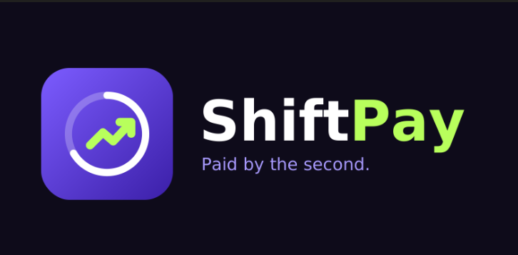
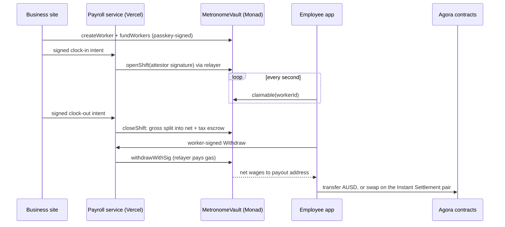

<p align="center"></p>

# ShiftPay

Get paid for the hours you have already worked, the moment you work them, on Monad.

ShiftPay is payroll for shift workers that pays as time passes instead of every two weeks. A
business deposits USDC or AUSD into a **payroll vault** and gives each employee an allocation.
When the business verifies a shift, the employee's wages grow every second, capped by the money
actually deposited, with tax held separately in escrow. The employee withdraws any amount at any
time, without paying gas and without a fee, and can send AUSD to anyone or cash out through
**Agora Instant Settlement**.

Nobody installs a wallet. The business and the employee each sign in with a **Mera passkey**,
which turns a fingerprint, face or PIN into a signing key inside the browser. No seed phrase,
no extension and no approval pop-ups.

Employees who would otherwise borrow against wages they have already earned are the people this
is built for. The money is already theirs; only the payment timing was wrong.

- **Network**: Monad testnet (chain 10143)
- **Contracts**: `contracts/`, Foundry
- **App**: Next.js business website and employee mobile wallet, in `app/`
- **Payroll service**: `bridge/`, runs inside the business Vercel project with Neon Postgres

| | |
|---|---|
| Business website | https://shiftpay-business.vercel.app |
| Employee mobile wallet | https://shiftpay-employee.vercel.app |
| USDC payroll vault | [`0xA1C794EA48A1D86294848D28E85c76328070DB24`](https://testnet.monadexplorer.com/address/0xA1C794EA48A1D86294848D28E85c76328070DB24) |

---

## 1. Two apps, one vault

### Business: a website

| Step | What the owner does | What happens underneath |
|---|---|---|
| Sign in | Unlock company passkey | The passkey's PRF output is turned into the company key in the browser tab, wiped after 15 minutes |
| Get money | Get 10,000 test AUSD, or test USDC | Agora's faucet `requestFunds` is called and signed by the passkey |
| Hire | Add employee: wallet, rate, tax %, allocation | `createWorker`, then `fundWorkers`, then a signed profile save |
| Verify work | Start / end verified shift | A signed clock intent goes to the payroll service, whose attestor signs and whose relayer submits |
| Watch | Overview, payments, tax escrow | Vault events indexed into Postgres; balances read live from the vault |

### Employee: a mobile wallet

| Step | What the worker does | What happens underneath |
|---|---|---|
| Sign in | Create passkey, share address from Receive | A different site, so a different passkey and a different address |
| Earn | Link employee ID, watch the balance grow | `claimable()` read every second; nothing is written as time passes |
| Withdraw | Tap Withdraw | Worker signs EIP-712 `Withdraw`; the employer's relayer submits and pays gas |
| Send | Send AUSD to family, any address | Plain ERC-20 transfer signed by the passkey |
| Cash out | Settle AUSD instantly | Agora pair `swapExactTokensForTokens`, fixed price, zero fee |

### End to end



---

## 2. The payroll vault

### How money moves

```
     BUSINESS                       VAULT (64 shards)                    EMPLOYEE
 ┌───────────────┐            ┌───────────────────────┐           ┌───────────────┐
 │ USDC / AUSD   │─fundWorkers▶│ funded allocation     │           │ payout wallet │
 │               │            │   │ accrues per second │           │               │
 │ reclaim       │◀─unearned──│   ▼ (verified shifts)  │─withdraw─▶│ net wages     │
 └───────────────┘            │ net ───────────────────┤           └───────────────┘
                              │ tax ──▶ tax escrow ────┼─remit──▶ fixed tax address
                              └───────────────────────┘
```

Money leaves the vault by three paths only: a worker-signed withdrawal to the registered payout
address, a remittance of escrowed tax to the employer's tax address, or the employer reclaiming
allocation that has not been earned. Each is bounded by deposited funds.

### Accrual arithmetic

Amounts are token base units (6 decimals). Each closed shift is split when it closes:

```
gross = ratePerHour × (endAt − startAt) / 3600
tax   = gross × withholdingBps / 10000      rounded down, in the worker's favour
net   = gross − tax
```

What the employee app shows:

```
claimable = max(0, min( earnedNet − withdrawn,
                        funded − earnedTax − withdrawn ))
```

**The second term is the part worth reading.** Earnings alone would let a worker draw money the
employer never deposited. Capping by `funded − earnedTax − withdrawn` means wages stop growing
when the allocation runs out, tax is reserved before net pay, and a top-up resumes accrual from
the moment it lands without back-paying the gap. Accrual is a `view`: no transaction is written
while time passes, so a ticking balance costs nothing.

### Design decisions

| Decision | Why |
|---|---|
| Fully funded, accrual capped by deposit | No credit, no advances, no lender. A worker can only take money that already exists. |
| `ratePerHour`, not per second | $24/h is 6,666.67 units/s at 6 decimals and cannot be stored exactly. |
| Tax address immutable per employer | If the admin could change it, withheld tax could be redirected. |
| Worker-signed withdrawals, relayer submits | The worker pays no gas, and the relayer cannot change amount or recipient. |
| 64 shards by `workerId % 64` | Workers in different shards write different storage, so a shift change of hundreds of clock-outs does not serialise. That is what Monad's parallel execution needs. |
| Per-shift replay records, no shared bitmap | A shared bitmap word would be written by every worker and become the bottleneck. |
| Over-withdrawals recovered from future accrual | A shorter final shift is netted against later earnings, never clawed back from a wallet. |

### The contracts

| File | Responsibility |
|---|---|
| `MetronomeVault.sol` | Employers, workers, funding, signed shifts and corrections, withdrawals, tax escrow and remittance |
| `ShardVault.sol` | Minimal clone per shard that holds tokens |
| `test/MetronomeVault.t.sol` | 36 unit and fuzz tests |
| `test/invariant/` | 5 stateful invariants: solvency, conservation, no unbacked claims, monotonic totals, all earnings funded |

---

## 3. Agora and Mera

The Agora bounty asks for a mobile app that sends AUSD across borders, with Mera passkey
onboarding and Agora's Instant Settlement contract on Monad testnet. Every line maps to a screen:

| Requirement | Where | Contract |
|---|---|---|
| Mobile app | Employee wallet, installable, phone-first | |
| Mera passkey onboarding | Both apps | `@category-labs/mera` |
| Send AUSD across borders, settled instantly | Send → *Abroad · instant settlement*: the sender's AUSD goes through Agora's pair and the recipient receives the settled currency in the same transaction | AUSD `0xa9012a055bd4e0eDfF8Ce09f960291C09D5322dC` |
| Instant Settlement | Cash out screen | CTK/AUSD pair `0x1Aa8958Aa34cEC8096EF4381cb335effe977b0ae` |
| Test AUSD | Get AUSD button | Faucet `0xd236c18D274E54FAccC3dd9DDA4b27965a73ee6C` |
| Agora public API | Live AUSD supply on Monad shown beside every transfer | `GET https://api.agora.finance/v0/metrics` |

The first cash-out registers the account with Agora's testnet whitelister
(`0x7c10F56d6f04a51376393a1C3670e966863F6BD5`), approves AUSD, then swaps. Each step is a
confirmed transaction with an explorer link. The pair is checked against Agora's published
token order before any swap.

### Mera is the entire account layer

| Requirement | How ShiftPay meets it |
|---|---|
| One-prompt onboarding | One passkey ceremony creates the account. No seed phrase, extension, email or OTP. |
| Prompt-free signing, scoped session | After unlocking, payroll actions sign without prompts for 15 minutes; then the key is wiped and the next action asks again. |
| Stateless test | Clear storage or use a new device: the passkey re-derives the same address, the app finds the payroll registered to that address on chain, and private payslips decrypt again. |
| Time to first transaction | New accounts get a small network-fee credit automatically from the payroll relayer (one per address, capped per day), so the first transaction needs no faucet. |
| No custody backend | Keys exist only in the browser tab. The server holds payroll records and ciphertext, never keys. |

### One passkey, many keys: private payslips

The wallet key comes from Mera's default PRF salt. Payslips use a second, unrelated namespace,
`sha256("shiftpay.payslips.v1")`. HKDF turns that PRF output into an AES-256-GCM key and an opaque storage id.
The phone encrypts each payslip; the server stores ciphertext under an id it cannot link to any wallet. On a
second device the same passkey re-derives the same key and id and the payslips decrypt live. Nothing secret
is persisted anywhere. See `app/lib/private-payslips.mjs` and its tests.

**On testnet the pair settles AUSD → CTK only.** The reverse quote returns zero, so the app
offers only the direction that works rather than a button that fails.

---

## 4. Hosting the payroll service on Vercel

The bridge is a Fastify service. Instead of a separate always-on server it is bundled into the
business Next.js app and served from `/api/bridge/*`.

| Concern | How it is handled |
|---|---|
| No resident process | After each request, `Submitter.settle()` submits queued transactions and waits for receipts within the function's time budget. Unfinished work resumes on the next request. |
| Database | Neon Postgres through the Vercel Marketplace, one schema per token. Prisma migrations run during the build. |
| Monad RPC limits | `eth_getLogs` is capped at 100 blocks and the public RPC at 25 requests/second. Vault events are indexed in paced parallel batches, and the cursor persists in Postgres so every function instance resumes where the last stopped. |
| Employee site | Relays to the business project with a shared secret. One payroll service, one source of truth. |
| Startup checks | Chain id, vault bytecode, settlement token, decimals, registered attestor and expected admin are verified before serving. A mismatch refuses to start. |

---

## 5. Trust, honestly

| Actor | Can | Cannot |
|---|---|---|
| Employer admin | Create workers, fund, reclaim unearned money, suspend, rotate attestor | Withdraw wages, redirect withheld tax, reclaim earned money |
| Attestor (payroll service) | Sign shift open, close and corrections | Move money, attest beyond funding, replay a shift |
| Relayer (payroll service) | Pay gas to submit signed records and withdrawals | Withdraw without the worker's signature, change amount or recipient |
| Employee | Withdraw up to `claimable`, any time | Draw unfunded or unverified wages |

The chain proves every paid amount traces to a signed shift and to deposited money. It does
**not** prove the hours were truly worked: that remains the employer's timekeeping, the same
trust a worker places in payroll today, except now every record is signed and public.

Withholding is a flat, employer-chosen rate held in escrow and sent to a fixed address. It is not
a statutory tax calculation and files nothing.

Gas is flat per transaction. A withdrawal used 116,205 gas at 102 gwei on Monad testnet (about
0.012 MON, 10 Oct 2026), the same for $1 or $500, so very frequent tiny withdrawals cost the
employer more per dollar paid.

---

## 6. Configuration and deployment

### Prerequisites

- Node 24, Foundry (`forge`)
- A Vercel account with Neon connected to the business project
- Test MON for the company account and the relayer

### Run locally

```bash
cd contracts && npm ci && forge test
cd ../bridge && npm ci && npm run generate && npm run typecheck
cd ../app && npm ci && npm run dev
```

Open http://localhost:3000/employer and /employee.

### Deploy

Create the company passkey and payroll vault from `/deploy` on the business site; it signs the
real deployment and employer registration. Then set both Vercel projects' variables from the
ignored keys file without printing secrets:

```bash
cd app
node scripts/configure-vercel.cjs
vercel deploy --prod
```

After deploying an AUSD vault, add it with
`node scripts/configure-vercel.cjs ausd <vault> <deployBlock> <employerId>` and redeploy.

### Environment

| Variable | Project | Set by | Purpose |
|---|---|---|---|
| `PAYROLL_BACKEND=local` | business | `configure-vercel.cjs` | Run the bridge in-process |
| `DATABASE_URL` | business | Neon integration | Postgres |
| `USDC_VAULT_ADDRESS`, `USDC_VAULT_DEPLOY_BLOCK`, `USDC_EMPLOYER_ID` | business | `configure-vercel.cjs` | Which vault to serve and index from |
| `USDC_ATTESTOR_PRIVATE_KEY`, `USDC_RELAYER_PRIVATE_KEYS` | business | `configure-vercel.cjs` | Shift signing and gas (same for `AUSD_`) |
| `EXPECTED_EMPLOYER_ADMIN` | business | `configure-vercel.cjs` | Refuse a vault whose admin is not the company passkey |
| `BRIDGE_ORIGIN`, `BRIDGE_RELAY_SECRET` | employee | `configure-vercel.cjs` | Relay to the business payroll service |
| `METRONOME_PRODUCT` | both | Vercel | `employer` or `employee` |

Private keys live only in `bridge/.env.runtime-keys` (gitignored) and Vercel's sensitive
variables. Nothing secret is `NEXT_PUBLIC`.

### Tests

| Command | Where | Covers |
|---|---|---|
| `forge test` | `contracts` | 36 unit/fuzz tests, 5 invariants |
| `npm run typecheck && npm test` | `bridge` | Types, unit and Postgres integration |
| `npm test` | `app` | 31 tests, including live read-only checks against Agora's contracts |
| `npm run test:live` | `app` | Both deployments: health, config vs chain, route separation, origin checks |

---

## Repository

```
contracts/   MetronomeVault, ShardVault, tests and invariants
bridge/      payroll service: attestor, relayer, indexer, Prisma schema
app/         Next.js: app/ routes, components/, lib/, styles/, scripts/, tests/
benchmark/   shift-change benchmark procedure and local harness results
docs/        PRD, architecture, trust model, setup, phases, demo, submission
```

## Further reading

- [`docs/METRONOME_PRD.md`](docs/METRONOME_PRD.md): product requirements and current status
- [`docs/architecture.md`](docs/architecture.md): the full ledger and accounting rules
- [`docs/trust-model.md`](docs/trust-model.md): failure bounds for each key
- [`docs/PHASES.md`](docs/PHASES.md): what is verified live and what remains
- [`docs/DEMO.md`](docs/DEMO.md): the demo script

Built for Monad Metropolis, Track 02 Consumer Products & Payments. MIT licence.
