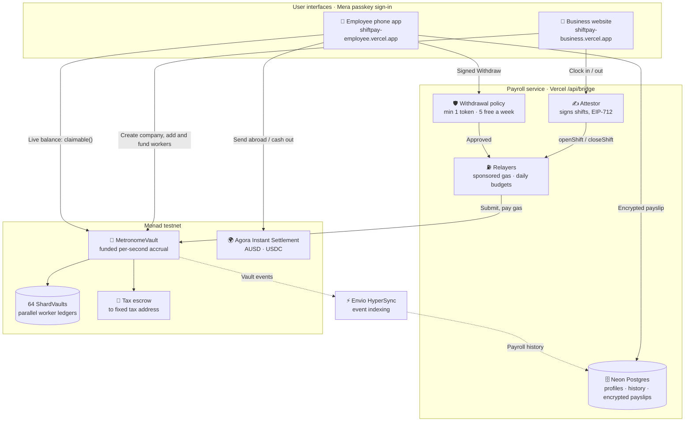
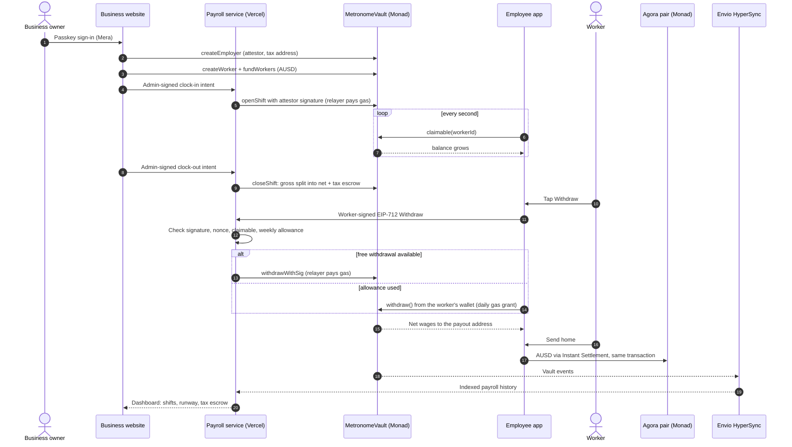

# ShiftPay — Product Requirements Document

**Hackathon:** Monad Metropolis
**Submission deadline:** 13 Oct 2026, 11:59 PM ET (14 Oct, 09:29 IST)
**Track:** 02 — Consumer Products & Payments
**Bounties:** Agora Cross-Border Payments · Best Mera-Powered UX · Mera: One Passkey, Many Keys · Best Use of Envio · Best Projects using Alchemy (being added)
**Team:** Lakshmikanth S (solo builder), final year, Loyola-ICAM College of Engineering and Technology, Chennai
**Document updated:** 13 Oct 2026

**Tagline:** **You earned it at 2pm. Why wait until the 15th?**

**One line:** ShiftPay pays wages as they are earned, second by second, so workers never borrow against money that is already theirs.

**Positioning:** Streaming apps run a timer. ShiftPay pays *wages*: employer-funded first, tied to signed shifts, tax withheld,
never clawed back. A wage is not a stream.

---

## Part A: ShiftPay explained simply

Read this part first. It needs no technical knowledge.

### The story in one minute

Priya works evening shifts at a café. She finishes a shift on the 2nd of the month, but her pay arrives on the 15th.
On the 5th her rent is due, so she borrows money and pays a fee to borrow her *own* wages.

ShiftPay fixes the timing. The café puts payroll money into a safe digital account first. While Priya works, her
pay grows on her phone every second. Whenever she needs money she taps **Withdraw**, and the money she has already
earned is hers within seconds. No loan, no fee. She can also send part of it to her family in another country,
and it arrives instantly.

### Who uses it

| Person | Uses | What they do |
|---|---|---|
| **The business** (the café) | A website: shiftpay-business.vercel.app | Puts payroll money in, adds employees, starts and ends shifts, sees who earned what |
| **The employee** (Priya) | A phone app: shiftpay-employee.vercel.app | Watches her pay grow, withdraws it, sends money home, keeps private payslips |

### The six steps of a working day

1. **The business adds money.** It moves dollars into the payroll vault and sets aside an amount for Priya.
2. **The business starts Priya's shift.** One click on the website.
3. **Priya's pay grows every second.** Her phone shows the number going up. It can never go above the money the
   business set aside, so the business can never owe more than it put in.
4. **Tax is set aside automatically.** A share the business chose (for example 10%) is held separately, so Priya
   only ever sees money that is really hers to take.
5. **Priya taps Withdraw.** The money moves to her account in about a second. The business pays the small
   network fee; Priya pays nothing.
6. **Priya sends money home or cashes out.** She can send dollars to anyone, or convert them to local currency
   instantly at a fixed price with no fee.

### How someone signs in (no passwords, no crypto wallet)

Both apps use a **passkey**: the same fingerprint, face or PIN you use to unlock your phone. The first time,
one scan creates the account. Later, one scan unlocks it. There is no password to forget, no 12-word recovery
phrase and no wallet app to install. Lose your phone? Sign in on a new one with the same passkey and everything
comes back.

### What is happening underneath (the parts users never see)

| Plain words | What it really is |
|---|---|
| "Safe digital account" for payroll | The **MetronomeVault** smart contract on the **Monad** blockchain. It holds the money and enforces the rules: pay only verified shifts, never more than deposited, tax kept aside. |
| "Dollars" | **USDC** and **AUSD**: digital dollars that stay worth one US dollar. AUSD is made by **Agora**. |
| The passkey account | **Mera** turns the passkey into a private key inside the browser. The key is never stored or sent anywhere and is wiped after 15 minutes. |
| "Instant send home" and "cash out" | **Agora Instant Settlement**: a fixed-price exchange contract that settles in the same transaction. |
| "The business pays the fee" | A ShiftPay **relayer** account, funded by the business, submits the employee's signed withdrawal and pays the network fee. New accounts also get a small free fee credit. |
| "Private payslips" | Payslips encrypted on the phone with a second key from the same passkey. The server stores only unreadable data. |
| The website and phone app | **Next.js** apps on **Vercel**. The business site also runs the payroll service and a **Neon Postgres** database for profiles and history. |

### Two ways to be paid

- **Shift pay:** pay grows every second while a verified shift is open.
- **Monthly salary:** the employer enters a monthly amount; it grows every second of the month (monthly ÷ 720 hours). Leaving mid-month pays exactly the time worked.

### Why it is safe

- **Priya cannot take more than she earned**, and never more than the business deposited.
- **The business cannot take back wages Priya already earned.** It can only take back unused money.
- **Nobody can redirect the tax money.** Its destination is fixed when the business is created.
- **The fee payer cannot steal or change a withdrawal.** It can only deliver what Priya signed.
- Every payment is recorded publicly, so either side can check it.

What ShiftPay cannot prove: that the hours were really worked. That is still the employer's word, the same as
payroll today, but now every shift is signed and recorded.

### Why Monad

At the end of a shift, many workers stop at once. Monad processes many transactions in parallel, with blocks
about every second and very low fees, so paying hundreds of people at the same moment is fast and cheap. The vault
spreads workers across 64 separate compartments so their payments do not get in each other's way.

---

## Part B: Current status, 13 Oct 2026

**Live:** business website https://shiftpay-business.vercel.app · employee phone app https://shiftpay-employee.vercel.app ·
code https://github.com/Lakshmikanth-3/ShiftPay

### B.1 What is built and verified

| Area | Status | Evidence |
|---|---|---|
| Payroll contract | Done | `MetronomeVault` + 64 `ShardVault` clones. 43 Foundry tests incl. 5 invariants (solvency, conservation, no unbacked claims, monotonic totals, all earnings funded). Slither: 26 results, 0 high, all triaged ([SECURITY.md](SECURITY.md)) |
| Business website | Done, live | Passkey company sign-up, AUSD/USDC currency switch, Overview, Employees (shift pay or monthly salary), Shifts, Funding (Agora faucet, tax remittance), Payments (Envio-indexed), Settings |
| Employee phone app | Done, live | Passkey sign-in, live per-second balance, Withdraw, Send abroad via Agora, direct transfer, Cash out, History, private payslips. Payroll found automatically from the passkey address, polled every 8 s until linked |
| Payroll service | Done, live | Fastify inside the business Next.js app (`/api/bridge/*`) on Vercel + Neon Postgres. Attestor, relayers, withdrawal policy, gas grants, dashboard API, HMAC time-clock webhook |
| Multi-company | Done | Any company self-onboards (`createEmployer` with the service attestor); 60 sponsored tx/day and 5 worker credits per self-serve company; 30 worker credits/day overall |
| Gas safety | Done | Sponsored withdrawals ≥ 1 AUSD/USDC (or whole balance), 5 free per worker per week, then direct `withdraw()` from the worker's wallet using the daily gas grant |
| Indexing / RPC | Done | Envio HyperSync (`/health` reports `envio-hypersync ok`); Alchemy RPC primary with public fallbacks |
| Brand | Done | New logo (circle-arrow dollar mark) and navy/blue/green theme across both apps, deck, report and videos |

### B.2 Deployments on Monad testnet (chain 10143)

| Item | Address |
|---|---|
| AUSD payroll vault | `0xc118d4E298284192DAabE328eC236c3468a9E185` (block 70080159, employer 1) |
| USDC payroll vault | `0xA1C794EA48A1D86294848D28E85c76328070DB24` (block 69456787, employer 1) |
| Agora AUSD faucet | `0xd236c18D274E54FAccC3dd9DDA4b27965a73ee6C` |
| Agora Instant Settlement pair | `0x1Aa8958Aa34cEC8096EF4381cb335effe977b0ae` |
| Home company admin (passkey) | `0x430ff06AB045911e5dC6B7a742ddC11f27F47487` |

**Recorded demo run (13 Oct 2026):** new company `0xadfab41f…c88da17ae75`, relayed withdrawal of 2.25 AUSD
`0x15988f83…daadf7e55`, send abroad via Agora `0xc8fb3cbb…3c691aa7efa7`. All confirmed on MonadScan.

### B.3 Proof and measurements

- **Live agent:** `npm run test:agent` drives both deployed sites with a virtual passkey: 26/26 checks with real transactions.
- **App tests:** 51 pass. **Bridge:** typecheck clean; unit, config, Envio tests pass; integration test covers relayed withdrawals, replays, forgeries and the minimum.
- **First five minutes (from the recorded run):** employee account ready in under 10 s; withdrawal from tap to confirmed in about 10 s; the worker never sees a wallet, seed phrase or gas.
- **Benchmark:** 96/96 transactions in a 16-worker shift change, about 2 s; no shard advantage measurable at this size, reported as-is ([benchmark/README.md](../benchmark/README.md)).
- **Monthly salary:** withdrawn mid-month on chain, gas paid by the relayer.

### B.4 Submission deliverables

| Deliverable | Status |
|---|---|
| Demo video (2:09, live product only, explorer receipts) | Made: `data/video/ShiftPay-demo.mp4` |
| Pitch video (≤ 2:00, team intro) | Made: `data/video/ShiftPay-pitch.mp4` |
| Agora bounty video (1:02: passkey onboarding, AUSD balance, completed send) | Made: `data/video/ShiftPay-agora.mp4` |
| Form logo (1000 × 1000) | Made: `data/video/ShiftPay-logo-1000.png` |
| Form text, 5 bounty answers, judge access steps | Written (submission kit) |
| Pitch deck (15 slides) and project report | Published |

### B.5 Remaining work (owner, before 14 Oct 09:29 IST)

1. Make the GitHub repository public (required: judges must verify the code).
2. Add the Alchemy bounty on the portal (an automated attempt did not persist) and confirm `MONAD_RPC_URL` is the Alchemy endpoint.
3. Upload the three videos to YouTube (unlisted) and paste all fields; press **Submit**; checklist must read 6/6.
4. Optional but valuable: a real user test with 2–5 classmates and a pilot "yes" from a campus café. **No user test has been run yet; no user numbers may be claimed until one is.**

### B.6 Known limits

Each limit and its plan is in [LIMITATIONS.md](LIMITATIONS.md): testnet only and unaudited; hours attested by the
employer; flat withholding rate; testnet cash-out to CTK; installable web app rather than a store app; no users yet.

---

**Precedents to acknowledge:** per-second pay ideas already exist on Monad (ShramPay, FlowPay; TickPay placed 3rd in a Monad AI hackathon payments track for usage micro-streaming). Our difference is in section 13: ShiftPay accrues against **attested work**, caps accrual at **funded balance**, withholds tax, never claws back, and hides the chain behind passkeys. A wage is not a vesting schedule.

---

## 5. Architecture

### System architecture



### One working day, end to end



The worker never pays gas for normal use and never manages keys. The employer's attestor signs every shift; the
vault is pre-funded, so no claim is ever unbacked. Workers can always call `withdraw()` themselves, so the relayer is
a convenience, not a gatekeeper.

---

## 6. The core mechanism

Three quantities per worker:

```text
earned     = Σ over attested shifts (ratePerSec × seconds)   ← lazy, computed
withheld   = earned × withholdingBps / 10000                  ← tax escrow
withdrawn  = cumulative taken out
claimable  = earned − withheld − withdrawn
```

Plus one hard safety rule:

```text
claimable <= allocated[worker]      // never pay what isn't funded
```

**Accrual is lazy.** Nothing is written as time passes. A shift attestation writes the shift record; `claimable()` is a view that integrates. Workers see a number ticking up in the UI that costs nobody anything.

### Mid-shift accrual

Workers want to see earnings rise *during* a shift, not after clock-out. So an open shift accrues optimistically against a clock-in attestation, capped at `maxShiftSeconds`:

```text
openSeconds = min(now − clockInAt, maxShiftSeconds)
```

On clock-out, the real duration replaces the estimate. If the worker withdrew against an over-estimate, the difference is recovered from **future accrual only** — never clawed back from their wallet. That asymmetry is non-negotiable and should be stated in the pitch; it is what separates this from an advance.

---

## 7. Contracts

> **Note.** The Solidity in 7.1–7.7 is the original design sketch. The deployed contract differs in places: rates are
> per hour (`ratePerHour`), mid-shift accrual uses checkpointed accrual segments so funding or rate changes keep earlier
> pay exact, token custody is split across 64 `ShardVault` clones, workers can call `withdraw()` directly while the
> relayer uses `withdrawWithSig`, and `createEmployer` is permissionless. See [architecture.md](architecture.md) for
> the as-built ledger.

### 7.1 Storage

```solidity
struct Worker {
    // slot 0
    uint128 ratePerSec;        // 6-dp stablecoin units per second
    uint128 allocated;         // employer-funded ceiling
    // slot 1  ← written on withdraw
    uint128 withdrawn;
    uint128 accruedSettled;    // from closed shifts
    // slot 2  ← written on clock in/out
    uint64  clockInAt;         // 0 = not on shift
    uint64  lastSettled;
    uint32  shard;
    uint16  withholdingBps;
    uint16  flags;             // bit0 active, bit1 suspended
    // slot 3
    address payoutAddr;
    uint64  owedBack;          // over-estimate recovery, future accrual only
    uint32  maxShiftSeconds;
}

mapping(uint256 => Worker) public workers;          // workerId → Worker
mapping(uint256 => address) public attestor;        // employerId → signer
mapping(uint256 => uint256) public allocShard;      // shard → allocated total
mapping(uint256 => uint256) public withheldShard;   // shard → tax escrow
mapping(uint256 => mapping(uint256 => uint256)) public shiftUsed; // replay bitmap
uint256 public unallocated;                         // cold path only
```

Four slots per worker. Clock-in/out writes slot 2 only. Withdrawal writes slot 1 only. **Two workers never touch the same slot.**

### 7.2 Shift attestation

```solidity
bytes32 constant SHIFT_TYPEHASH = keccak256(
  "Shift(uint256 workerId,uint64 startAt,uint64 endAt,uint128 ratePerSec,uint256 shiftId,uint64 deadline)"
);

function closeShift(
    uint256 workerId,
    uint64 startAt,
    uint64 endAt,
    uint128 ratePerSec,
    uint256 shiftId,
    uint64 deadline,
    bytes calldata sig
) external {
    require(block.timestamp <= deadline, "expired");
    require(endAt > startAt, "bad window");
    Worker storage w = workers[workerId];
    require(w.flags & SUSPENDED == 0, "suspended");

    bytes32 digest = _hashTypedData(keccak256(abi.encode(
        SHIFT_TYPEHASH, workerId, startAt, endAt, ratePerSec, shiftId, deadline
    )));
    require(ECDSA.recover(digest, sig) == attestor[employerOf[workerId]], "bad attestor");
    _useShift(workerId, shiftId);                       // replay bitmap

    uint256 gross = uint256(ratePerSec) * (endAt - startAt);

    // recover any over-estimate from THIS accrual, never from the wallet
    if (w.owedBack != 0) {
        uint256 cut = gross < w.owedBack ? gross : w.owedBack;
        gross -= cut;
        w.owedBack -= uint64(cut);
    }

    w.accruedSettled += uint128(gross);
    w.clockInAt = 0;
    w.lastSettled = uint64(block.timestamp);

    emit ShiftClosed(workerId, shiftId, startAt, endAt, gross);
}
```

### 7.3 Claimable — the view that drives the UI

```solidity
function claimable(uint256 workerId) public view returns (uint256) {
    Worker storage w = workers[workerId];
    uint256 gross = w.accruedSettled;

    if (w.clockInAt != 0) {                             // mid-shift estimate
        uint256 secs = block.timestamp - w.clockInAt;
        if (secs > w.maxShiftSeconds) secs = w.maxShiftSeconds;
        gross += uint256(w.ratePerSec) * secs;
    }
    if (w.owedBack != 0) {
        gross = gross > w.owedBack ? gross - w.owedBack : 0;
    }

    uint256 net = gross - (gross * w.withholdingBps / 10000);
    if (net <= w.withdrawn) return 0;
    uint256 avail = net - w.withdrawn;

    uint256 room = w.allocated > w.withdrawn ? w.allocated - w.withdrawn : 0;
    return avail < room ? avail : room;                 // funded ceiling
}
```

### 7.4 Withdrawal

```solidity
function withdraw(uint256 workerId, uint256 amount) external {
    Worker storage w = workers[workerId];
    require(msg.sender == w.payoutAddr || msg.sender == relayer, "not worker");
    uint256 avail = claimable(workerId);
    require(amount != 0 && amount <= avail, "exceeds claimable");

    w.withdrawn += uint128(amount);
    // only per-worker slot + one sharded total are written
    allocShard[w.shard] -= amount;

    IERC20(token).safeTransfer(w.payoutAddr, amount);
    emit Withdrawn(workerId, amount, avail - amount);
}
```

The ERC-20 transfer is unavoidable here — delivery *is* the product — but it writes the worker's own token balance plus the vault's. Shard the vault's holdings across sub-vaults by `shard` so withdrawals in different shards don't contend on one balance slot.

### 7.5 Funding and the solvency alarm

```solidity
function fundWorkers(uint256[] calldata ids, uint256[] calldata amounts) external
function allocationRunway(uint256 workerId) external view returns (uint64 seconds_)
```

`allocationRunway` returns how long the worker can keep accruing before hitting the funded ceiling. The dashboard alarms below a configured threshold. **An underfunded vault must stop accrual, never create an unbacked claim** — the instant you let claims exceed funding you have become a lender.

### 7.6 Withholding

Payroll cannot pay gross. `withholdingBps` routes a share into `withheldShard`, releasable only to the employer's designated tax address:

```solidity
function remitWithholding(uint256[] calldata shards, address taxAddr) external onlyEmployer
```

Most hackathon projects ignore this. Including it is the single clearest signal to a judge that you understand payroll rather than streaming.

### 7.7 Function surface

```solidity
createEmployer(address attestor, address taxAddr)
createWorker(uint256 workerId, WorkerConfig cfg, address payoutAddr)
setRate(uint256 workerId, uint128 ratePerSec)
setWithholding(uint256 workerId, uint16 bps)
openShift(uint256 workerId, uint256 shiftId, bytes sig)
closeShift(...)
correctShift(uint256 shiftId, uint128 correctGross, bytes sig)  // future accrual only
fundWorkers(uint256[] ids, uint256[] amounts)
withdraw(uint256 workerId, uint256 amount)
remitWithholding(uint256[] shards, address taxAddr)
suspend(uint256 workerId) / reinstate(uint256 workerId)
claimable(uint256) view
allocationRunway(uint256) view
```

---

## 8. Off-chain

### 8.1 Attestation bridge

As built: the payroll service (Fastify, bundled into the business Next.js app at `/api/bridge/*`) signs shifts for
every company that registered its attestor. Shifts start and end from the business dashboard (admin-signed clock
intents, 10-minute deadline, unique nonce), or from an external time clock or POS system through the HMAC-signed
`/webhooks/clock` endpoint. Relayers submit the signed transactions and pay gas within daily per-company budgets.

**Batch the submission, not the execution.** Group closing shifts **by shard** and submit one transaction per shard, so Monad executes them concurrently. One large `closeShiftBatch()` call would run sequentially inside the EVM and forfeit the entire benefit — say this in the pitch.

### 8.2 Worker app

- Mera passkey sign-in (face, fingerprint or PIN), no seed phrase, no extension
- A number that ticks upward in real time, driven by the `claimable` view
- One button: **Withdraw** (minimum 1 AUSD/USDC or the whole balance; 5 sponsored a week, then direct from the wallet)
- Shift history with the signed attestation behind each line
- Gas sponsored by the employer via a relayer; a small daily gas grant for direct actions
- Send AUSD abroad through Agora Instant Settlement; private payslips encrypted with a second passkey key

The ticking number is the entire emotional product. Build it first and make it beautiful.

---

## 9. Tech stack (as built)

| Layer | Choice |
|---|---|
| Contracts | Solidity, Foundry, OpenZeppelin (SafeERC20, EIP-712, Clones) |
| Chain | Monad testnet, chain id 10143; Alchemy RPC primary for the payroll service, public RPC fallbacks (monadinfra, Ankr, dRPC) |
| Accounts | **Mera** passkeys (`@category-labs/mera`): PRF-derived keys, no seed phrase, no extension |
| Frontend | Next.js 16 (App Router), React 19, viem, plain CSS |
| Payroll service | Fastify app bundled into the business Next.js project, served at `/api/bridge/*` on Vercel |
| Database | Neon Postgres via the Vercel Marketplace, Prisma, one schema per token |
| Settlement | USDC and Agora AUSD; Agora Instant Settlement pair for send-abroad and cash-out |
| Indexing | Envio HyperSync feeds vault events into Postgres with a persisted cursor |
| Testing | Forge unit/fuzz/invariant, Vitest, Node test runner, CDP live agent with virtual passkey, Slither |
| Hosting | Vercel (two projects: business and employee) |

Bounty focus: **Agora cross-border payments**, **Best Mera-Powered UX**, **Mera: One Passkey, Many Keys**, **Best Use of Envio** and **Best Projects using Alchemy**.
Privy was removed so Mera is the entire account layer.

---

## 10. MVP scope

### Must have
- [x] `MetronomeVault.sol` on Monad: attested accrual, funded ceiling, withholding
- [x] EIP-712 shift attestation with replay bitmap
- [x] Lazy `claimable()` with mid-shift estimate
- [x] Instant withdrawal, any amount, zero fee
- [x] Worker PWA with the live ticking balance and one-tap withdraw
- [x] Employer dashboard: funding, runway alarm, per-worker ledger
- [x] **Shift-change burst benchmark:** run on Monad testnet (16 workers, 96 transactions, 0 failures); designs equal at this scale, see benchmark/README.md
- [x] Foundry unit + invariant suite green

### Should have
- [x] Passkey login (Mera) and employer-sponsored gas
- [x] Withholding remittance flow: "Send to tax account" on the business Funding page calls `remitWithholding`
- [ ] Over-estimate recovery demo
- [ ] Clock-in/out PWA for workers — employer starts/ends verified shifts from the business dashboard instead
- [x] Monthly salary mode (monthly ÷ 720 h, up to 31 days)
- [x] Self-serve companies with daily gas budgets
- [x] Minimum sponsored withdrawal and weekly free allowance
- [x] Private payslips (second PRF namespace)

### Nice to have
- [ ] Overtime multipliers
- [ ] Multi-employer workers
- [ ] CSV import of a real shift roster

### Do not build
Credit or advances, a token, governance, cross-chain, tax filing, a full HR suite.

---

## 11. Demo script (3 min cap) — as recorded

The submitted demo (2:09) is a real run on the live sites with no slides, narrated:

1. Business signs up with one passkey; company created on chain, fee sponsored.
2. Funds payroll with 10,000 test AUSD from Agora's faucet.
3. Employee creates her passkey on the phone and shares her address.
4. Business registers and funds her (shift pay, 10% withholding, 200 AUSD).
5. Manager starts a verified shift (attestor signs, relayer pays gas).
6. Her payroll appears automatically; the balance grows every second.
7. She withdraws 2.25 AUSD; gas paid by the employer.
8. MonadScan receipt: success, called the vault, AUSD to her address.
9. She sends AUSD home through Agora Instant Settlement; receipt shown.
10. Private payslip saved.
11. Manager ends the shift; tax escrow and Envio-indexed history; close.

---

## 12. Market, PMF and traction

### Who pays

**Employers.** Many already buy EWA as a retention benefit. ShiftPay replaces it with something that costs workers nothing — a straightforward upgrade to pitch internally.

### Market sizing — bottom-up

Do **not** quote the $43B payday lending market as your TAM; you're not lending. Build from pricing:

```text
addressable = target workers × per-worker-per-month fee
```

The EWA market at **$9.2B (2025) → $38.4B (2034)** is the right comparable, because that is what employers and workers already pay for partial access to earned wages. Your claim is that a continuous ledger makes most of that spend unnecessary.

### PMF evidence

1. **Demand is already paid for.** 10M workers took $32B in advances in 2022 and ~90% paid a fee. People are *buying* a worse version of this today.
2. **It is growing fast.** +90% transaction growth in a single year.
3. **The pricing is indefensible.** $520 to access $375 invites regulation, and EWA has been called "payday lending on steroids" by critics. Employers do not want to be associated with that.
4. **Employers already carry the cost** of turnover driven by cash-flow stress.

### Why a chain

- **Workers can verify their own ledger.** Every accrual traces to a signed shift record the employer cannot silently alter.
- **Funded-only accrual is enforceable**, so a claim can never exceed money actually set aside. A database can promise that; a contract proves it.
- **Cross-border contractors** have no shared payroll system to trust.

Concede the limit honestly: for a single domestic employer with a trusted payroll provider, a well-built internal system could do much of this. The argument strengthens with contractors, multiple jurisdictions, and workers who have reason not to trust the employer's numbers.

### Traction status (13 Oct 2026)

No users, employers or payroll volume yet; none are claimed. The product is live for anyone to try, and any business can self-onboard. Next: a user test with classmates and a campus pilot.

### Traction targets for 7 days (original plan)

- **8–12 conversations** with shift employers or gig platforms. One question: *do you offer earned wage access, and what does it cost you?*
- **2–3 workers** who use the PWA through a real simulated shift and say whether the ticking balance changes how they feel.
- **1 design partner** willing to pilot a roster, named with permission.
- Benchmark reproducible from the repo.

Claim no payroll volume, employers or users you do not have.

### Business model

- Per active worker per month, paid by the employer: proposed ₹49 (about US$0.60), network fees included
- Optional treasury yield on the funded-but-unwithdrawn float — **disclose this**, because it is exactly where the incentives could turn predatory
- Never a worker-side fee. That is the product.

---

## 13. Competition

| Alternative | Why it falls short |
|---|---|
| Payday lenders | $520 to borrow $375. The thing being replaced |
| EWA providers (Earnin, DailyPay, Payactiv) | Charge ~90% of users a fee per access; still a batch cycle with a lender bolted on |
| Weekly or daily payroll runs | Still a batch, just a shorter one. Doesn't help on day three |
| Streaming protocols (Sablier, Superfluid) | Stream a committed amount on a schedule. No attested work, no funded ceiling, no withholding — a vesting schedule, not a wage |
| ShramPay, FlowPay (Monad projects) | Per-second wage or salary streams on Monad testnet. No signed shifts, no funded ceiling enforcement, no tax escrow, wallet-based sign-in |
| TickPay (3rd, Monad AI hackathon payments track) | Usage-based micro-streaming: a customer pays a service per second. Opposite direction (purchase, not wages); no work attestation or withholding |

---

## 14. Risks

| Risk | Mitigation |
|---|---|
| **"This is just token streaming"** | Attested work, funded ceiling, withholding, over-estimate recovery. A wage is not a vesting schedule. Demo all four |
| **Becoming a lender** | Accrual never exceeds attested work **and** funded balance. Accrual halts rather than creating a claim. Say it explicitly |
| **Over-estimate abuse mid-shift** | Capped by `maxShiftSeconds`; recovery only from future accrual, never the wallet |
| **Employer underfunds** | Runway alarm; accrual stops at the ceiling. Workers see real numbers, not promises |
| **Attestor key compromise** | Bounded by funded allocation; rotation is one transaction; corrections possible on future accrual |
| **Regulatory surface (withholding, minimum wage)** | Scope to one jurisdiction for the pitch; present withholding as a hook, not a compliance claim |
| **No users yet** | Run a classmate user test and a campus pilot; claim nothing until measured |
| **No real employer yet** | Judges and any business can self-onboard with a passkey; free campus pilot planned |
| **Relayer gas cost** | Daily per-company budgets; minimum sponsored withdrawal and 5 free a week, then direct withdrawal |
| **Float yield looks predatory** | Disclose it in the pitch before anyone asks |

---

## 15. Security requirements

```text
claimable(w) <= allocated[w] − withdrawn[w]          always
withdrawn[w] <= net earned                            always
Σ allocShard[i] + unallocated == vault balance        (within rounding)
a shiftId settles at most once
only attestor[employer] can attest a shift
corrections never reduce `withdrawn`, only future accrual
suspended workers cannot accrue or withdraw
withheld funds are only remittable to taxAddr
```

### Foundry test matrix

```text
test_accrual_matches_rate_times_seconds
test_midshift_estimate_capped
test_closeshift_replaces_estimate
test_overestimate_recovered_from_future_only
test_never_claws_back_withdrawn
test_withdraw_capped_by_allocation
test_accrual_halts_when_underfunded
test_withholding_routed_to_escrow
test_withholding_only_to_taxAddr
test_shift_replay_reverts
test_wrong_attestor_reverts
test_suspended_cannot_withdraw
test_shard_totals_match_balance
testFuzz_claimable_never_exceeds_funded
invariant_vault_solvency
invariant_no_unbacked_claims
```

`invariant_no_unbacked_claims` is the one to feature. It is the difference between payroll and lending.

---

## 16. Build plan — 7 days

| Day | Deliverable |
|---|---|
| 1 | `Worker` layout, lazy `claimable()`, mid-shift estimate. Unit tests |
| 2 | EIP-712 attestation, replay bitmap, funded ceiling, withholding. Invariants |
| 3 | Deploy to Monad. Naive control contract. Shift-burst benchmark + chart |
| 4 | **Worker PWA with the live ticking balance and one-tap withdraw** |
| 5 | Employer dashboard, funding, runway alarm. Mera passkeys + sponsored gas |
| 6 | Attestation bridge, clock-in/out flow, CSV roster, over-estimate demo |
| 7 | README, demo video, submission fields, bounty checklists. Freeze and rehearse |

Cut order: CSV import, then the bridge, then withholding remittance. **Never cut the ticking balance** — it is the product — **or the burst benchmark** — it is the Monad argument.

---

## 17. Repository

```text
ShiftPay/
├── contracts/   MetronomeVault, ShardVault, tests and invariants (Foundry)
├── bridge/      payroll service: attestor, relayer, indexer, gas grants, Prisma schema
├── app/
│   ├── app/         routes: /employer, /employee, /deploy, /api/bridge
│   ├── components/  business-app, wallet-app, deployment, payroll state
│   ├── lib/         agora, mera, private-payslips, rpc, funding, tokens, ABI
│   ├── styles/      CSS per portal
│   ├── scripts/     build helpers and configure-vercel
│   └── tests/       unit tests, live checks, automated passkey agent
├── benchmark/   shift-change benchmark procedure and local results
└── docs/        this PRD, architecture, trust model, use case, user testing, judge access
```

---

## 18. Submission checklist

- [ ] Public repo (owner must switch visibility to public), MIT licence
- [x] Dependencies and AI-tool use declared in the README
- [x] Contracts deployed on Monad testnet, addresses in the README
- [x] Live product link (employee app) on Monad testnet
- [x] Benchmark run on testnet and documented
- [x] Demo video ≤ 3 minutes, product only (made; upload pending)
- [x] Pitch video ≤ 2 minutes with team intro (made; upload pending)
- [x] Agora bounty video ≤ 2 minutes (made; upload pending)
- [x] Logo ≥ 500 px for the form
- [x] Track 02 — Consumer Products & Payments
- [x] Agora, Mera, Envio and Alchemy answers written; requirements mapped in [BOUNTIES.md](BOUNTIES.md)
- [ ] Alchemy bounty selected on the portal
- [x] Security review and Slither triage ([SECURITY.md](SECURITY.md)); limitations and roadmap ([LIMITATIONS.md](LIMITATIONS.md))
- [ ] Form submitted (checklist 6/6) before 14 Oct, 09:29 IST

---

## 19. The pitch

> Twelve million people pay four point six billion dollars a year in payday loan fees. The average borrower pays five hundred and twenty dollars to borrow three hundred and seventy-five. Ten million more took thirty-two billion in wage advances, and ninety per cent of them paid a fee for it.
>
> All of that is money they had already earned.
>
> They pay it because payroll settles every two weeks, and rent is due on the first. The two-week cycle isn't a policy. It's a leftover from when paying a million people individually was too expensive to do more than twice a month.
>
> ShiftPay deletes the gap. You clock in, your balance rises, you take it whenever you want, and it costs you nothing — because there's no advance to charge for. Nothing is ever lent. You can only draw what you've worked for and what's already funded.
>
> I'm Lakshmikanth S, a final-year student at Loyola-ICAM College of Engineering and Technology in Chennai, building ShiftPay solo.
>
> At two p.m. an entire warehouse clocks out at once. Every one of those attestations is independent, and we built the accounting so none of them collide.
>
> **We're not a better advance. We removed the thing you'd be advancing against.**

---

## 20. Judge Q&A

**How is this different from ShramPay, FlowPay or TickPay?** They stream money on a timer or charge per second of usage. ShiftPay pays wages: funded first, tied to signed shifts, tax withheld, never clawed back, and the worker never sees crypto.

**Isn't this just token streaming?** Streaming pays out a committed amount on a clock. ShiftPay accrues against **attested work**, caps at **funded balance**, withholds tax, and recovers over-estimates from future earnings only. Those four things are what make it a wage.

**Why does it need a blockchain?** The worker can verify their own ledger — every accrual traces to a shift record signed by the employer, who cannot silently change it. And funded-only accrual is enforced rather than promised. For one domestic employer with a trusted provider, a good internal system gets close; the argument strengthens with contractors and cross-border work.

**Doesn't a million workers streaming mean a million transactions a second?** No, and we don't claim it. Accrual is a view and costs nothing. The real load is synchronised shift changes and bursty withdrawals. Our testnet run (96 transactions, about 2 s) is small; at 16 workers sharding showed no advantage yet, and we report that honestly.

**Are you a lender?** No, and the invariant suite proves it. Accrual can never exceed attested work or funded money. If the employer underfunds, accrual stops — we never create a claim we can't honour.

**What if the employer attests a shift wrongly?** Corrections apply to future accrual. We never claw money back from a worker's wallet. If the employer is wrong in their favour, that's their loss, not the worker's.

**How do you make money?** Per active worker per month, from the employer. We also could earn yield on funded-but-unwithdrawn float — we're flagging that ourselves, because it's the one place where our incentives could drift against workers.

---

## Appendix: Sources

- [CFPB — Developments in the Paycheck Advance Market](https://www.consumerfinance.gov/data-research/research-reports/data-spotlight-developments-in-the-paycheck-advance-market/)
- [UW Evans School — Earned Wage Access report (PDF)](https://evans.uw.edu/wp-content/uploads/2025/08/EWA-Report-1.pdf)
- [The true cost of payday loans](https://stream.co/en-us/articles/the-true-cost-of-payday-loans-what-american-workers-and-employers-need-to-know)
- [CNBC — "payday lending on steroids"](https://www.cnbc.com/2024/01/28/why-one-expert-called-earned-wage-access-payday-lending-on-steroids.html)
- [Earned wage access market size](https://dataintelo.com/report/earned-wage-access-market)
- [Payday lending market size](https://www.mordorintelligence.com/industry-reports/payday-lending-market)
- [Monad Metropolis](https://monad.xyz/developers/hackathons/metropolis)

**Verify every figure against its primary source before pitching.** The CFPB report is the strongest primary source here — read it directly rather than relying on summaries.
