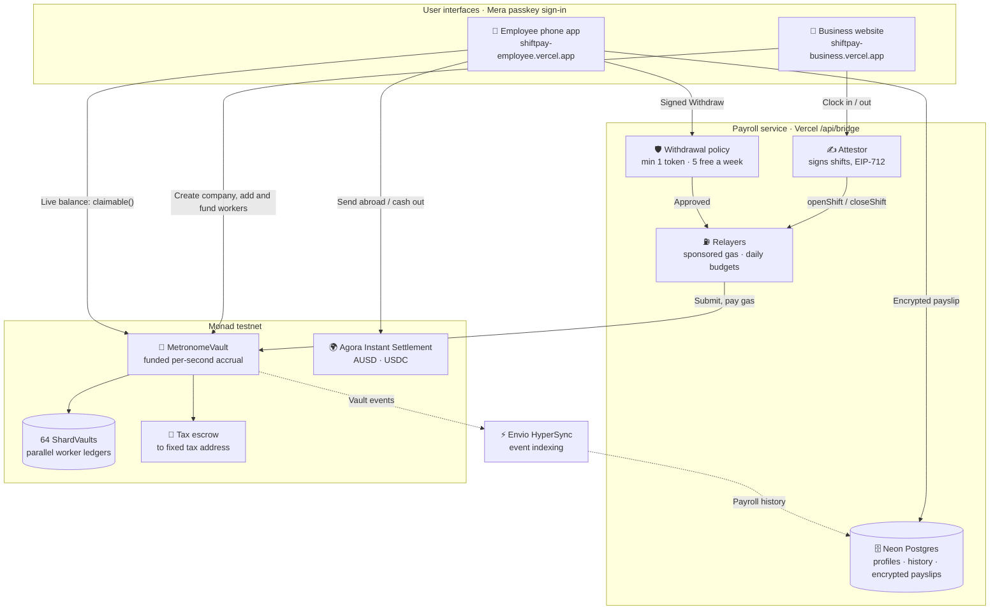
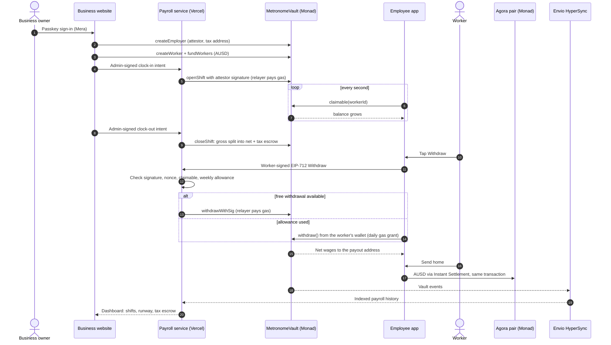

# ShiftPay — Product Requirements Document

| | |
|---|---|
| **Hackathon** | Monad Metropolis 2026 |
| **Track** | 02 — Consumer Products & Payments |
| **Bounties** | Agora Cross-Border Payments · Best Mera-Powered UX · Mera: One Passkey, Many Keys · Best Use of Envio · Best Projects using Alchemy |
| **Builder** | Lakshmikanth S (solo), final year, Loyola-ICAM College of Engineering and Technology, Chennai |
| **Deadline** | 14 Oct 2026, 09:29 IST (13 Oct, 11:59 PM ET) |
| **Status** | Built and live on Monad testnet (§4) |

**Tagline:** You earned it at 2pm. Why wait until the 15th?

**One line:** Streaming apps run a timer. ShiftPay pays wages: employer-funded, tied to signed shifts, tax withheld,
never clawed back. Paid every second on Monad, with passkey sign-in and instant transfers home through Agora.

**Live:** business https://shiftpay-business.vercel.app · employee https://shiftpay-employee.vercel.app ·
code https://github.com/Lakshmikanth-3/ShiftPay

---

## Contents

1. [ShiftPay explained simply](#1-shiftpay-explained-simply)
2. [The problem](#2-the-problem)
3. [The product](#3-the-product)
4. [Current status and proof](#4-current-status-and-proof)
5. [Architecture](#5-architecture)
6. [The core mechanism](#6-the-core-mechanism)
7. [Smart contracts](#7-smart-contracts)
8. [Payroll service](#8-payroll-service)
9. [The two apps](#9-the-two-apps)
10. [Sponsor integrations](#10-sponsor-integrations)
11. [Tech stack](#11-tech-stack)
12. [Security and trust](#12-security-and-trust)
13. [Testing](#13-testing)
14. [Market, competition and business model](#14-market-competition-and-business-model)
15. [Go-to-market](#15-go-to-market)
16. [Risks](#16-risks)
17. [Limits and roadmap](#17-limits-and-roadmap)
18. [Demo and pitch](#18-demo-and-pitch)
19. [Judge Q&A](#19-judge-qa)
20. [Repository and submission](#20-repository-and-submission)
21. [Sources](#21-sources)

---

## 1. ShiftPay explained simply

Read this part first. It needs no technical knowledge.

### The story in one minute

Priya works evening shifts at a café. She finishes a shift on the 2nd of the month, but her pay arrives on the 15th.
On the 5th her rent is due, so she borrows and pays a fee to borrow her *own* wages.

ShiftPay fixes the timing. The café puts payroll money into a safe digital account first. While Priya works, her pay
grows on her phone every second. Whenever she needs money she taps **Withdraw**, and the money she has already earned
is hers within seconds. No loan, no fee. She can also send part of it to her family in another country instantly.

### Who uses it

| Person | Uses | What they do |
|---|---|---|
| **The business** (the café) | Website: shiftpay-business.vercel.app | Funds payroll, adds employees, starts and ends shifts, sees who earned what, pays tax |
| **The employee** (Priya) | Phone app: shiftpay-employee.vercel.app | Watches pay grow, withdraws, sends money home, keeps private payslips |

### A working day in six steps

1. **The business adds money** into the payroll vault and sets an amount aside for Priya.
2. **The manager starts Priya's shift** with one click.
3. **Priya's pay grows every second** on her phone. It can never go above what the business set aside.
4. **Tax is set aside automatically** (for example 10%), so Priya only sees money that is really hers.
5. **Priya taps Withdraw.** The money arrives in seconds. The business pays the network fee.
6. **Priya sends money home or cashes out** instantly, at a fixed price with no fee.

### Signing in

Both apps use a **passkey**: the fingerprint, face or PIN that unlocks the phone. One scan creates the account; one
scan unlocks it later. No password, no 12-word recovery phrase, no wallet app. On a new phone, the same passkey
brings everything back.

### What happens underneath

| Plain words | What it really is |
|---|---|
| Safe digital payroll account | **MetronomeVault** smart contract on **Monad** |
| Dollars | **AUSD** (Agora) and **USDC** stablecoins, each worth US$1 |
| The passkey account | **Mera** derives a private key from the passkey inside the browser; never stored, wiped after 15 minutes |
| Send home and cash out | **Agora Instant Settlement**: a fixed-price exchange that settles in the same transaction |
| The business pays the fee | A ShiftPay **relayer** submits the employee's signed withdrawal and pays gas |
| Private payslips | Encrypted on the phone with a second key from the same passkey |
| Payroll history | Indexed from the chain by **Envio HyperSync** |

### Why it is safe

- Priya can never take more than she earned, or more than the business deposited.
- The business can never take back wages already earned; it can only reclaim unused money.
- Nobody can redirect the tax money; its destination is fixed when the company is created.
- The fee payer can only deliver what Priya signed; it cannot change the amount or recipient.
- Every payment is public, so either side can check it.

What ShiftPay cannot prove: that the hours were really worked. That is still the employer's word, as in payroll
today, but now every shift is signed and recorded.

---

## 2. The problem

Work happens every hour. Payroll pays every two weeks or once a month. People living shift to shift close that gap by
borrowing against wages they have already earned.

| Figure | Source |
|---|---|
| **$4.6B** a year in US payday-loan fees, paid by 12M+ mostly low-income people | Pew Charitable Trusts |
| **$32B** taken early by 10M workers via wage-advance apps in 2022; ~90% paid a fee | CFPB, 2024 |
| **$520** in fees, on average, to borrow **$375** between paydays | Pew |
| Earned-wage-access market **$9.2B (2025) → $38.4B (2034)** | Industry estimate |

Migrant workers pay a second time: sending money home costs fees and takes days. Employers lose staff to cash-flow
stress, and workers cannot check what they are owed until payday.

**Who we serve first:** hourly shift workers in hospitality, delivery and retail; salaried staff who want earned pay
before month-end; migrant workers who send money home; and, for the first pilot, part-time student workers in Chennai.

---

## 3. The product

### The principle: a wage is not a stream

Money-streaming apps pay a committed amount on a timer. Payroll needs four things a stream does not have:

| Property | What ShiftPay does |
|---|---|
| **Funded first** | The employer deposits before work starts. Pay can never exceed funding, so it is never a loan |
| **Tied to verified work** | Each shift is an EIP-712 record signed by the employer's attestor and settled on chain |
| **Tax withheld** | Every second's gross pay is split into net wages and tax escrow, payable only to a fixed tax address |
| **Never clawed back** | Employers reclaim only unearned money; corrections reduce future pay, never a withdrawn balance |

### Two pay types

| Pay type | For | How it accrues |
|---|---|---|
| **Shift pay** | Hourly workers | Only while a verified shift is open. 36 AUSD/hour = 0.01 AUSD per second |
| **Monthly salary** | Salaried staff | Monthly ÷ 720 hours, every second for up to 31 days. Leaving mid-month pays exactly the time worked |

Both use the same contract; a salary is a shift with a long maximum length (`app/lib/pay-plans.mjs`).

### Comparison

| | Payday loan | Wage-advance app | Money streaming | **ShiftPay** |
|---|---|---|---|---|
| Worker pays a fee | Yes, high | Usually | Gas | **No** |
| Is it a loan? | Yes | An advance | No | **No, funded first** |
| Tied to verified work | No | Estimated | No, a timer | **Signed shifts** |
| Tax set aside | No | No | No | **On-chain escrow** |
| Worker can verify pay | No | No | Yes | **Yes, on chain** |
| Crypto knowledge needed | No | No | Yes, a wallet | **No, a passkey** |

---

## 4. Current status and proof

| Area | Status | Evidence |
|---|---|---|
| Payroll contract | Done | `MetronomeVault` + 64 `ShardVault` clones; 43 Foundry tests incl. 5 invariants; Slither triaged, 0 high ([SECURITY.md](SECURITY.md)) |
| Business website | Done, live | Passkey company sign-up, AUSD/USDC switch, Overview, Employees (shift pay or salary), Shifts, Funding (Agora faucet, tax remittance), Payments (Envio-indexed), Settings |
| Employee app | Done, live | Passkey sign-in, per-second balance, Withdraw, Send abroad via Agora, direct transfer, Cash out, History, private payslips; payroll found automatically from the passkey address |
| Payroll service | Done, live | Fastify inside the business Next.js app on Vercel + Neon Postgres: attestor, relayers, withdrawal policy, gas grants, dashboard API, time-clock webhook |
| Multi-company and gas safety | Done | Any company self-onboards; daily sponsored-gas budgets; withdrawal minimum and weekly allowance |
| Indexing and RPC | Done | Envio HyperSync (`envio-hypersync ok`); Alchemy RPC primary with public fallbacks |
| Brand | Done | ShiftPay logo and navy/blue/green theme across apps, deck, report and videos |

### Deployments (Monad testnet, chain 10143)

| Item | Address |
|---|---|
| AUSD payroll vault | `0xc118d4E298284192DAabE328eC236c3468a9E185` (block 70080159, employer 1) |
| USDC payroll vault | `0xA1C794EA48A1D86294848D28E85c76328070DB24` (block 69456787, employer 1) |
| Agora AUSD faucet | `0xd236c18D274E54FAccC3dd9DDA4b27965a73ee6C` |
| Agora Instant Settlement pair | `0x1Aa8958Aa34cEC8096EF4381cb335effe977b0ae` |
| Home company admin (passkey) | `0x430ff06AB045911e5dC6B7a742ddC11f27F47487` |

### Transactions from the recorded demo (13 Oct 2026)

| Step | Transaction |
|---|---|
| New company created (sponsored fee) | `0xadfab41f5914ee673b642fc6e05f12fce5b1b3ffff68e57219384c88da17ae75` |
| Relayed withdrawal, 2.25 AUSD | `0x15988f83ccdf82ac2b2a3b1e38f8c2863cc31d11cafaaa300570a2bdaadf7e55` |
| Send abroad via Agora | `0xc8fb3cbb0dc8efc2ae9da693818f8f5d06bf95233027021f48ae3c691aa7efa7` |

### Measured first five minutes (from the recorded run)

- Employee account: one passkey scan, ready in under 10 seconds.
- Withdrawal: tap to confirmed on Monad in about 10 seconds, gas paid by the employer.
- Words the worker never sees: wallet, seed phrase, gas.

No user test has been run yet; no user numbers are claimed.

---

## 5. Architecture

Three layers. The apps run in the browser with Mera passkeys. The payroll service runs on Vercel and never holds user
keys. Money and payroll rules live only in the vault on Monad.

### System architecture



### One working day, end to end



| Component | Role |
|---|---|
| Business website | Company sign-up, funding, employees, shifts, tax remittance, payment ledger |
| Employee app | Live balance, withdraw, send and cash out via Agora, history, private payslips |
| Payroll service | Fastify app bundled into the business Next.js project at `/api/bridge/*` |
| Neon Postgres | Profiles, shift and transaction records, ciphertext payslips; one schema per token |
| MetronomeVault | Holds funds, accrues per second, escrows tax, pays withdrawals |
| 64 ShardVaults | Hold tokens per shard so workers never share a balance slot |
| Agora | AUSD, faucet, Instant Settlement pair, public metrics API |
| Envio HyperSync | Indexes vault events into Postgres with a persisted cursor |

---

## 6. The core mechanism

### Lazy accrual

Nothing is written as time passes. A shift writes a start time; pay is computed when read.

```text
openGross  = min(rate × (now − clockInAt) / 3600, funding ceiling)    ← computed on read
net, tax   = split(gross, withholdingBps)
earnedNet  = netSettled + net(openGross)
claimable  = min(earnedNet − withdrawn,  funded − (earnedTax + withdrawn))
```

The ticking balance costs nobody anything: the phone calls the `claimable()` view.

### Funded ceiling

```text
claimable ≤ funded − tax reserved − withdrawn       always
```

If funding runs out, accrual stops. The contract never creates a claim it cannot pay. That is the line between
payroll and lending, and `invariant_no_unbacked_claims` checks it.

### Accrual segments

When funding, rate or status changes during an open shift, the vault records an **accrual segment**
(`startAt, grossStart, ceiling, rate`). Pay earned before the change keeps its old terms exactly; pay after it uses
the new ones.

### Settlement and corrections

`closeShift` replaces the running estimate with the attested final gross, splits it into `netSettled` and
`taxSettled`, and moves tax into escrow. If a worker withdrew against an estimate that turns out too high, the
difference (`owedBack`) is recovered from **future accrual only**. `correctShift` works the same way. Money already
withdrawn is never taken back.

---

## 7. Smart contracts

`contracts/src/MetronomeVault.sol` (Solidity 0.8.28, OpenZeppelin SafeERC20, EIP-712, ECDSA, Clones) and
`ShardVault.sol` (64 minimal clones holding tokens per shard).

### 7.1 Storage

```solidity
struct Employer { address admin; address attestor; address taxAddr; }   // taxAddr fixed at creation

struct Worker {
    uint128 ratePerHour;  uint128 funded;          // slot 0: rate and funding
    uint128 withdrawn;    uint128 netSettled;      // slot 1: withdrawals, settled pay
    uint128 taxSettled;   uint128 taxEscrowed;     // slot 2: tax
    uint64 clockInAt; uint64 nonce; uint64 employerId;
    uint32 maxShiftSeconds; uint16 withholdingBps; uint8 flags;   // slot 3
    address payoutAddr;                            // slot 4
    uint256 openShiftId;                           // slot 5
}

struct AccrualSegment { uint64 startAt; uint128 grossStart; uint128 ceiling; uint128 rate; }
```

Each worker's state lives in its own slots. Shard totals (`alloc[employer][shard]`, `withheld[employer][shard]`) are
split 64 ways, so workers in different shards never write the same storage.

### 7.2 Signed messages (EIP-712)

```text
OpenShift(uint256 workerId, uint256 shiftId, uint64 startAt, uint64 deadline)
Shift(uint256 workerId, uint64 startAt, uint64 endAt, uint128 ratePerHour, uint256 shiftId, uint64 deadline)
Correction(uint256 shiftId, uint128 correctGross, uint32 version, uint64 deadline)
Withdraw(uint256 workerId, uint256 amount, uint64 nonce, uint64 deadline)
```

Shift messages are signed by the employer's attestor; `Withdraw` by the worker's payout address. Each shift settles
once; each withdrawal uses the worker's next nonce.

### 7.3 Function surface

| Function | Caller | Purpose |
|---|---|---|
| `createEmployer(attestor, taxAddr)` | Anyone | Register a company; caller becomes admin |
| `rotateAttestor` | Admin | Replace a compromised attestor in one transaction |
| `createWorker` / `setRate` / `setWithholding` / `setMaxShift` | Admin | Configure employees |
| `suspend` / `reinstate` | Admin | Stop or resume accrual and withdrawals |
| `fundWorkers(employerId, ids, amounts)` | Admin | Deposit; one transfer per touched shard |
| `reclaim(workerId, amount)` | Admin | Return only unearned, unreserved funds |
| `remitWithholding(employerId, shardIds)` | Admin | Pay escrowed tax to the fixed tax address |
| `openShift` / `closeShift` / `correctShift` | Anyone, with attestor signature | Start, settle, correct shifts |
| `withdrawWithSig` | Relayer, with worker signature | Gasless withdrawal to the payout address |
| `withdraw` | Worker | Direct withdrawal, no relayer needed |
| `setPayoutAddr` | Worker | Move the payout address |
| `earned` / `claimable` / `owedBack` / `arrears` / `reclaimable` / `allocationRunway` | View | Live numbers for the apps |

---

## 8. Payroll service

Fastify + TypeScript + zod + Prisma in `bridge/`, bundled into the business Next.js app at `/api/bridge/*`. The
employee site relays to it with a shared secret.

| Part | Behaviour |
|---|---|
| **Attestor** | Signs shifts for every company that registered this service's attestor. Clock requests need the admin's signature, a 10-minute deadline and a unique nonce. Time clocks and POS systems can post to the HMAC-signed `/webhooks/clock` |
| **Relayers** | One per vault. A queue (`Submitter.settle()`) submits, waits for receipts and retries with backoff |
| **Withdrawal policy** | Sponsored withdrawals: at least 1 AUSD/USDC (or the whole balance), 5 per worker per week; after that the app calls `withdraw()` directly, so wages are never locked |
| **Gas protection** | Self-serve companies: 60 sponsored transactions and 5 worker fee credits a day; 30 credits a day overall. New accounts 0.1 MON once; workers 0.2 MON a day |
| **Indexer** | Envio HyperSync reads vault events into Postgres; RPC event source as a fallback |
| **Dashboard API** | Signed 10-minute access proofs; profile writes are single-use |
| **Startup checks** | Refuses to serve if chain id, vault code, token, decimals, attestor or admin do not match |
| **Multi-company** | `employers.ts` serves any company whose attestor equals the service attestor |

---

## 9. The two apps

### Business website

Overview, Employees, Shifts, Funding, Payments and Settings. Adding an employee picks shift pay or monthly salary,
rate, withholding and funding in one form, signed by the company passkey. Funding shows the company wallet, an Agora
faucet button on testnet, tax remittance and a low-runway warning. Payments shows the indexed ledger and indexer
status.

### Employee app

Home shows earned wages growing every second, tax set aside and amount withdrawn, with one **Withdraw** button. Send
offers "Send abroad · instant" through Agora and a direct transfer. Cash out settles AUSD at a fixed price. History
lists receipts. Profile holds private payslips. The app finds the employee's payroll automatically from the passkey
address, in either currency, and checks again every 8 seconds until it appears.

### Design

Navy, blue and green from the ShiftPay logo; plain words (AUSD and USDC amounts, no "gas" or "wallet" on the
worker's home screen); installable on a phone home screen.

---

## 10. Sponsor integrations

| Sponsor | How ShiftPay uses it |
|---|---|
| **Agora** | Wages paid in AUSD; send abroad through the Instant Settlement pair in the same transaction; cash out; AUSD faucet for funding; live data from Agora's public `/v0/metrics` API |
| **Mera (UX)** | The only account layer for both apps; PRF-derived key in the browser; 15-minute session; stateless re-login restores account and payroll |
| **Mera (Many Keys)** | Private payslips: separate PRF namespace `shiftpay.payslips.v1` → HKDF-SHA-256 → AES-256-GCM key and storage id; server stores ciphertext only |
| **Envio** | HyperSync indexes all vault events; powers payroll history, payroll lookup by address, company lists and gas budgets; health reports `envio-hypersync ok` |
| **Alchemy** | Primary Monad RPC for the payroll service (submissions, receipts, live reads, startup checks), with public RPCs as fallbacks |

Line-by-line requirement mapping: [BOUNTIES.md](BOUNTIES.md).

---

## 11. Tech stack

| Layer | Technology |
|---|---|
| Contracts | Solidity 0.8.28, Foundry, OpenZeppelin |
| Chain | Monad testnet, chain id 10143 |
| Accounts | Mera (`@category-labs/mera`), WebAuthn PRF |
| Frontend | Next.js 16 (App Router), React 19, viem, plain CSS |
| Payroll service | Fastify, TypeScript, zod, Prisma |
| Database | Neon Postgres via the Vercel Marketplace |
| Payments | Agora AUSD, USDC, Agora Instant Settlement |
| Indexing and RPC | Envio HyperSync; Alchemy RPC with public fallbacks |
| Hosting | Vercel (two projects) |
| Testing | Forge unit/fuzz/invariant, Vitest, Node test runner, CDP agent with a virtual passkey, Slither |

---

## 12. Security and trust

### Invariants the contract enforces

```text
claimable(w) ≤ funded(w) − taxReserved(w) − withdrawn(w)     always
withdrawn(w) ≤ net earned(w)                                 always
shard balances cover every allocation and tax escrow         always
a shiftId settles at most once
only the employer's attestor can attest a shift
corrections reduce future accrual only, never `withdrawn`
suspended workers cannot accrue or withdraw
withheld tax can only go to the fixed taxAddr
```

### Controls

| Area | Control |
|---|---|
| Keys | Passkey keys only in the browser tab; service keys only in Vercel sensitive variables; none in git history |
| API | Same-origin or timing-safe relay secret on POST; 64 KB bodies; strict zod schemas |
| Withdrawals | Worker signature, nonce and deadline; the relayer cannot change amount or recipient |
| Gas | Daily per-company budgets; withdrawal minimum and weekly allowance |
| Reviewed and fixed | Gas-drain path for self-serve companies (daily budgets); RPC exhaustion (caching) |

Full review and Slither triage: [SECURITY.md](SECURITY.md). Trust model: [trust-model.md](trust-model.md).

---

## 13. Testing

| Check | Result |
|---|---|
| `forge test` | 43 pass: 38 unit and fuzz, 5 invariants (solvency, conservation, no unbacked claims, monotonic totals, all earnings funded) |
| Bridge | Typecheck clean; unit, config and Envio tests; integration test for relays, replays, forgeries and the minimum |
| App | 51 tests (passkey derivation, funding, Agora, payslips, pay plans) |
| Live agent (`npm run test:agent`) | 26/26 on the deployed sites with real Monad transactions |
| Slither (102 detectors) | 26 results, 0 high, 0 true positives |
| Benchmark | 96/96 transactions in a 16-worker shift change, about 2 s; no shard advantage measurable at this size ([benchmark/README.md](../benchmark/README.md)) |
| Monthly salary | Withdrawn mid-month on chain, gas paid by the relayer |

---

## 14. Market, competition and business model

### Sizing

Do not quote the payday-loan market as TAM; ShiftPay is not lending. The comparable is earned-wage access
($9.2B → $38.4B by 2034): what employers and workers already pay for partial access to earned pay.

```text
addressable revenue = active workers × ₹49 (≈ US$0.60) per month
```

### Competition

| Alternative | Why it falls short |
|---|---|
| Payday lenders | $520 to borrow $375 |
| EWA apps (Earnin, DailyPay, Payactiv) | Fee per access; still a batch cycle with a lender attached |
| Daily or weekly payroll | A shorter batch; does not help mid-cycle |
| Streaming protocols (Sablier, Superfluid) | A committed amount on a timer: no verified work, funding cap or withholding |
| Per-second pay projects on Monad (ShramPay, FlowPay; TickPay for usage micro-streaming) | Streams without signed shifts, tax escrow, passkey accounts or cross-border sending |

### Business model

- **₹49 (≈ US$0.60) per active employee per month**, paid by the employer, network fees included.
- Workers never pay.
- Possible later: yield on funded-but-unwithdrawn float, disclosed openly because it is where incentives could drift
  against workers.

---

## 15. Go-to-market

1. **First users:** part-time student workers and campus employers (canteens, cafés, event staff) at Loyola-ICAM
   College, Chennai: paid late, need small amounts often, reachable in person.
2. **Pilot:** free 30 days with one campus employer; measure withdrawals per worker, time to first withdrawal,
   retention and payroll time saved.
3. **Expand** through the pilot employer's network to nearby cafés, delivery fleets and retail shops.
4. **Migrant-worker employers**, where instant AUSD transfers home save a fee every pay cycle; add a licensed
   bank/UPI off-ramp.

Growth is employer-led: one employer brings its whole workforce; workers join by scanning a QR code at the start of a
shift. Employers adopt it for lower turnover, a recruiting perk ("paid the same day"), no cash handling, and
automatic withholding.

We claim no users, employers or payroll volume we do not have.

---

## 16. Risks

| Risk | Mitigation |
|---|---|
| "This is just token streaming" | Lead with funded ceiling, signed shifts, withholding, no clawback |
| Becoming a lender | Accrual can never exceed work or funding; it halts instead |
| Over-estimate mid-shift | Capped by `maxShiftSeconds`; recovered from future pay only |
| Employer underfunds | Runway warning; accrual stops at the ceiling |
| Attestor key compromise | Bounded by funded allocation; `rotateAttestor` in one transaction |
| Relayer gas cost | Daily budgets, withdrawal minimum, weekly allowance |
| Regulation (withholding, wage law) | Withholding is a hook, not a compliance claim; one jurisdiction at a time |
| No users yet | Self-serve onboarding; campus pilot planned |

---

## 17. Limits and roadmap

| Limit | Done now | Next |
|---|---|---|
| Testnet, unaudited | Invariant tests, Slither triage | Audit; deposit caps at launch |
| Hours attested by employer | Signed shifts, admin-signed clock events, time-clock webhook | Worker co-signed shifts; in-app dispute via `correctShift` |
| Flat tax rate | Per-worker withholding in escrow | Country tax tables; tax reports from on-chain records |
| Employer pays gas | Budgets, minimum, allowance | Batched withdrawals; gas inside the fee |
| Funding locked up front | Runway warning; reclaim unearned funds | Automatic top-up |
| Testnet cash-out to CTK | Agora Instant Settlement | Licensed bank/UPI off-ramp |
| First-use confusion (withdrawal minimum, paused earning, 15-minute re-login) | Withdraw card explains the minimum; a "Earning paused" notice when funding runs out | "Trust this device today" session option |
| Small benchmark | 96 transactions measured honestly | Hundreds of workers from several senders |
| Web app, not store app | Installable mobile web app | Android Trusted Web Activity |

Details: [LIMITATIONS.md](LIMITATIONS.md).

---

## 18. Demo and pitch

| Deliverable | Content | File |
|---|---|---|
| Demo video, 2:09 | Live product only: business passkey sign-up → Agora AUSD funding → employee passkey → register and fund → start shift → balance grows every second → withdraw 2.25 AUSD → MonadScan receipt → send abroad via Agora and its receipt → private payslip → end shift, tax escrow, Envio history | `data/video/ShiftPay-demo.mp4` |
| Agora bounty video, 1:02 | Passkey onboarding → AUSD balance → completed cross-border send → receipt | `data/video/ShiftPay-agora.mp4` |
| Pitch video, under 2:00 | Team intro, problem, solution, why Monad, proof, business model | `data/video/ShiftPay-pitch.mp4` |
| Form logo | 1000 × 1000 PNG | `data/video/ShiftPay-logo-1000.png` |
| Pitch deck | 15 slides | Published |

### Pitch script (opening)

> I'm Lakshmikanth S, a final-year student at Loyola-ICAM College of Engineering and Technology in Chennai, building
> ShiftPay solo. You earned it at two p.m. Why wait until the fifteenth?
>
> Workers pay billions a year in payday and wage-advance fees on money they have already earned, because payroll
> pays every two weeks. ShiftPay removes the gap instead of lending into it: the employer funds a vault, wages grow
> every second of verified work, tax is set aside, and workers withdraw any time with no fee and no crypto to learn.
>
> **We're not a better advance. We removed the gap.**

---

## 19. Judge Q&A

**Isn't this token streaming?** Streaming pays a committed amount on a timer. ShiftPay accrues against signed work,
caps at real funding, withholds tax and never claws back. Those four things make it a wage.

**Why a blockchain?** The worker can verify every line of their pay against a shift the employer signed, and
funded-only accrual is enforced rather than promised. For one domestic employer a good internal system gets close;
the case strengthens with contractors and cross-border work.

**Why Monad?** About 1-second blocks and sub-cent fees make per-second pay and on-demand withdrawals practical. The
vault's 64 shards keep workers' storage separate for parallel execution; at our 16-worker test the advantage was not
yet measurable, and we say so.

**Are you a lender?** No. The invariant suite proves accrual never exceeds work or funding.

**What if a shift is wrong?** Corrections apply to future pay. Money already withdrawn is never taken back.

**How do you make money?** ₹49 per active employee per month from the employer. Workers never pay.

---

## 20. Repository and submission

```text
ShiftPay/
├── contracts/   MetronomeVault, ShardVault, tests and invariants (Foundry)
├── bridge/      payroll service: attestor, relayer, policy, indexer, Prisma schema
├── app/         Next.js: routes, components, lib (agora, mera, payslips, rpc, pay plans), tests, scripts
├── benchmark/   shift-change benchmark procedure and results
└── docs/        this PRD, architecture, security, limitations, bounties, setup, user testing
```

### Submission checklist

- [ ] GitHub repository public (owner; judges must verify the code)
- [x] MIT licence; dependencies and AI-tool use declared in the README
- [x] Contracts live on Monad testnet; addresses in the README
- [x] Live product links
- [x] Demo, pitch and Agora videos made; owner uploads to YouTube (unlisted)
- [x] Form text, 5 bounty answers and judge access steps written
- [ ] Alchemy bounty added on the portal; confirm `MONAD_RPC_URL` is the Alchemy endpoint (owner)
- [ ] All fields pasted and **Submit** pressed; checklist 6/6 (owner)
- [ ] Optional: real user test with 2–5 classmates; pilot "yes" from a campus café

---

## 21. Sources

- [CFPB — Developments in the Paycheck Advance Market](https://www.consumerfinance.gov/data-research/research-reports/data-spotlight-developments-in-the-paycheck-advance-market/)
- [Pew Charitable Trusts — Payday lending in America](https://www.pewtrusts.org/en/research-and-analysis/reports/2012/07/19/who-borrows-where-they-borrow-and-why)
- [UW Evans School — Earned Wage Access report (PDF)](https://evans.uw.edu/wp-content/uploads/2025/08/EWA-Report-1.pdf)
- [Earned wage access market size](https://dataintelo.com/report/earned-wage-access-market)
- [Monad Metropolis](https://monad.xyz/developers/hackathons/metropolis)

Verify every figure against its primary source before quoting it.
